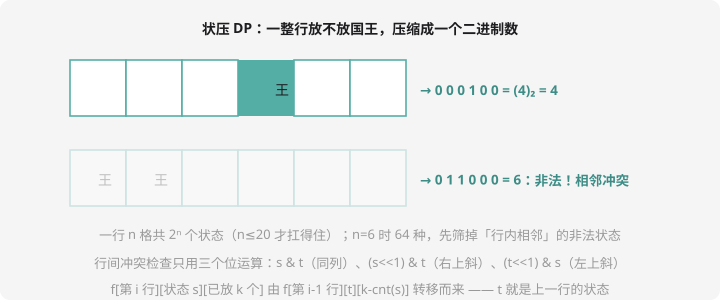

# 状压 DP

## 什么状态需要「压缩」？

有些 DP 的状态不是「第 i 个」也不是「区间 l~r」，而是**「一个集合」**：哪些课程修过了、哪些城市访问过了、哪几列放了棋子……

集合有 $2^n$ 种（每个元素在/不在），直接存集合太贵。但第 9 章的位运算给了我们礼物：**一个 int 的 32 个二进制位，恰好可以表示 32 个元素的「在/不在」**——每个状态变成一个整数，数组直接当下标。



## 三个必备位运算（第 9 章回收）

```cpp
s & (1 << k)      // 检查 k 在不在集合里（非零 = 在）
s | (1 << k)      // 把 k 放进集合
s ^ (1 << k)      // 把 k 移出集合（k 一定在时）
```

外加判断「整行/整个状态」合法性：

```cpp
if (s & (s << 1)) // 行内有相邻 1 → 非法（自己和自己错位与一下）
```

## 适用边界（先泼冷水）

$2^{20} \approx 10^6$ 扛得住，$2^{25}$ 就爆了——**状压 DP 的 n 一般 ≤ 20**。看到题目 n ≤ 20 且「选择之间有相互影响（相邻/依赖）」，基本可以断定是状压。

## 经典例题：互不侵犯

> **题目描述**　$N \times N$ 的棋盘上放 $K$ 个国王，国王可攻击相邻的 8 个格子（上下左右 + 四个斜角）。求互不攻击的放置方案总数。
>
> **输入格式**　一行两个整数 $N$、$K$。
>
> **输出格式**　一个整数。
>
> **数据范围**　$1 \le N \le 9$，$0 \le K \le N \times N$。
>
> **样例输入 / 样例输出**
>
> ```text
> 3 2
> ```
>
> ```text
> 8
> ```

**思路分析** 逐行放置——**每行的放法压成一个 N 位二进制数**。先预筛「行内合法」的状态（没有相邻 1），再逐行转移。

**状态**：`f[i][s][k]` = 第 i 行放成状态 s、前 i 行共放 k 个国王的方案数。

**转移**：第 i-1 行状态 t 转到 i 行 s，要求 s、t 互不攻击（三个位运算检查），国王数累加：

$$f[i][s][k] = \sum_{t \compatible s} f[i-1][t][k - cnt(s)]$$

**参考代码**

```cpp
#include <iostream>
#include <vector>
using namespace std;

long long f[10][512][100];    // [行][状态 0~2^9-1][已放国王数]
vector<int> legal;             // 行内合法状态
int cnt[512];                  // 每个状态的国王数（1 的个数）
int N, K;

bool ok2(int a, int b) {       // 上下两行兼容？
    if (a & b) return false;            // 同列：垂直冲突
    if ((a << 1) & b) return false;     // 斜向冲突
    if ((b << 1) & a) return false;
    return true;
}

int main() {
    cin >> N >> K;
    for (int s = 0; s < (1 << N); s++) {
        if (s & (s << 1)) continue;     // 行内有相邻 1：非法
        legal.push_back(s);
        int c = 0;
        for (int k = 0; k < N; k++)
            if (s & (1 << k)) c++;
        cnt[s] = c;
    }

    f[0][0][0] = 1;                     // 第 0 行（哨兵）空状态
    for (int i = 1; i <= N; i++)        // 逐行
        for (int s : legal)
            for (int t : legal) {
                if (!ok2(s, t)) continue;
                for (int k = cnt[s]; k <= K; k++)
                    f[i][s][k] += f[i-1][t][k - cnt[s]];
            }

    long long ans = 0;
    for (int s : legal) ans += f[N][s][K];   // 最后一行所有状态求和
    cout << ans << endl;
    return 0;
}
```

这就是洛谷 [P1896 互不侵犯](https://www.luogu.com.cn/problem/P1896)（SCOI2005）。验证 $N=3, K=2$：合法行状态 5 个（000、001、010、100、101），逐对检查兼容、数方案——程序输出 8。棋盘类状压的标准姿势：**预处理合法行状态 → 逐行转移 → 兼容用三连位运算**。

## 第二例：旅行商问题（TSP）

> 给定 $n$ 个城市的距离矩阵，从城市 0 出发，**每个城市恰好经过一次**再回到 0，求最短总路程。

「每个城市恰好一次」——集合本体的约束，状压的招牌：

**状态**：`f[S][j]` = 已访问集合为 S、当前停在城市 j 的最短路长。

**转移**：从 j 走到未访问的 k：

$$f[S | (1 << k)][k] = \min(f[S][j] + d[j][k])$$

复杂度 $O(2^n \times n^2)$，$n = 20$ 时约 $4 \times 10^8$——压线可过，这正是状压的极限刻度。

```cpp
memset(f, 0x3f, sizeof f);
f[1][0] = 0;                        // 集合 {0}，停在 0
for (int S = 1; S < (1 << n); S++)
    for (int j = 0; j < n; j++) {
        if (!(S & (1 << j))) continue;
        for (int k = 0; k < n; k++) {
            if (S & (1 << k)) continue;     // k 已访问过
            f[S | (1 << k)][k] = min(f[S | (1 << k)][k], f[S][j] + d[j][k]);
        }
    }
// 答案 = min over j: f[(1<<n)-1][j] + d[j][0]
```

洛谷 [P1171 售货员的困难](https://www.luogu.com.cn/problem/P1171) 是同款题。

## 状压的三步流水线

1. **识别集合**：「哪些……了」的状态 + n ≤ 20 → 状压
2. **预处理合法状态**：先把不可能的状态筛掉（如行内相邻），经常能砍掉一大半
3. **写出转移**：新状态 = 旧状态 + 一个元素，检查新旧集合的兼容性（位运算三件套）

## 动手试一试

1. 手算：`(5 >> 1) & 1`、`5 | (1 << 2)`、`6 & 3` 各等于多少？（9 章位运算复习）
2. 数一数 $N=3$ 时有多少个「行内合法」状态（答案 5），列举它们
3. 改造互不侵犯：求放 K 个国王的**最大攻击覆盖面积**之类变体，转移怎么改？
4. 挑战：P2704 [NOI2001] 炮兵阵地——二维相邻（隔一行隔一列）攻击，状态要存**两行**，f[i][s][t]，想想为什么？（提示：炮兵攻击距离 2）

---

**第 12 章毕业！** 线性、区间、树形、状压四种 DP 形态全部到手。下一章换口味：[第 13 章 · 字符串算法](../stralgo/index.md)。
