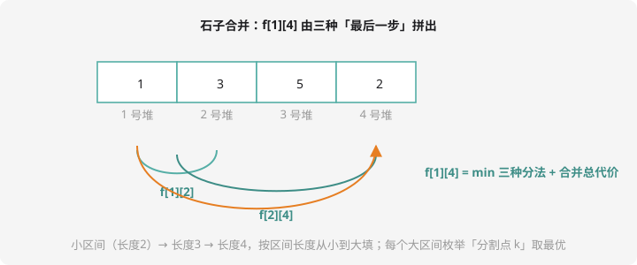

# 区间 DP

## 一类新视角：从「区间」定义状态

之前的状态是「前 i 个」「到第 i 行」——都是**前缀**。区间 DP 的状态是**一段区间** `f[l][r]` = 「把第 l 到 r 个（合并/处理完）的最优值」。

转移的共同套路：**枚举分割点 k**，把 `[l, r]` 拆成 `[l, k]` 和 `[k+1, r]` 两半，两半各自最优、拼起来：

$$f[l][r] = \min_{k = l}^{r-1} \left( f[l][k] + f[k+1][r] + \text{cost}(l, r) \right)$$

**计算顺序**：大区间依赖小区间 → **按区间长度从小到大填**（长度 1 → 2 → … → n），而不是按 l 或 r 的顺序。



## 经典原型：石子合并

$n$ 堆石子排成一排，每次**只能合并相邻**两堆，代价为新堆重量。全部合成一堆，最小总代价？

为什么不能贪心（每次合并最小的两堆）？——合并果子（第 10 章）里的堆**可以任选**；这里**只能合并相邻的**，每次合并会改变「谁挨着谁」，贪心眼光太短。区间 DP 正面刚：

**状态**：`f[l][r]` = 把 l~r 合成一堆的最小代价。
**转移**：最后一次合并一定是「左半堆 + 右半堆」，枚举分割点：

$$f[l][r] = \min_{k} \left( f[l][k] + f[k+1][r] \right) + S[l][r]$$

`S[l][r]` = 区间石子总和（最后一堆无论怎么分，都要被整体合并一次——**用前缀和 O(1) 取**）。边界 `f[i][i] = 0`。

## 例题：石子合并（直线版）

> **题目描述**　$n$ 堆石子排成一排，每堆石子数为 $a_i$。每次选相邻两堆合并，代价为新堆的石子数。求最小总代价。
>
> **输入格式**　第一行一个整数 $n$；第二行 $n$ 个整数。
>
> **输出格式**　一个整数。
>
> **数据范围**　$1 \le n \le 300$，$1 \le a_i \le 100$。
>
> **样例输入 / 样例输出**
>
> ```text
> 4
> 1 3 5 2
> ```
>
> ```text
> 22
> ```

**思路分析**　手动验算：方案 `{1,3} 先合`（代价 4）→ `{5,2} 合`（7）→ 两大堆合（11），总 $4 + 7 + 11 = 22$。三重循环（长度、左端点、分割点）填表，右下角 `f[1][n]` 即答案。复杂度 $O(n^3)$——$n \le 300$ 恰好是为它设计的范围。

**参考代码**

```cpp
#include <iostream>
using namespace std;

long long f[305][305], s[305];   // s = 前缀和

int main() {
    int n;
    cin >> n;
    for (int i = 1; i <= n; i++) {
        cin >> s[i];
        s[i] += s[i-1];           // 前缀和：S[l][r] = s[r] - s[l-1]
    }

    for (int len = 2; len <= n; len++)            // 区间长度
        for (int l = 1; l + len - 1 <= n; l++) {  // 左端点
            int r = l + len - 1;
            f[l][r] = 1e18;
            for (int k = l; k < r; k++)           // 分割点
                f[l][r] = min(f[l][r], f[l][k] + f[k+1][r]);
            f[l][r] += s[r] - s[l-1];             // 最后整体合并一次
        }
    cout << f[1][n] << endl;
    return 0;
}
```

洛谷 [P1775 石子合并（弱化版）](https://www.luogu.com.cn/problem/P1775) 与本题同款；环形版 [P1880](https://www.luogu.com.cn/problem/P1880)（NOIP1995 经典）需「断环成链」：把数组复制一份接在后面，做长度 $2n$ 的区间 DP，再从所有长度为 n 的窗口取最优。

## 三层循环的记忆框架

```cpp
for (int len = 2; len <= n; len++)         // ① 长度从小到大
    for (int l = 1; l + len - 1 <= n; l++) // ② 左端点
        for (int k = l; k < r; k++)        // ③ 分割点
            转移 f[l][r] = 优化( f[l][k] + f[k+1][r] + cost );
```

判断「是不是区间 DP」的信号词：**合并相邻**、**回文**、**括号匹配**、**区间取反/染色**……凡是「最后一步合并/处理整个区间的左右两半」的结构都逃不掉。

## 例题 2：关路灯（区间 DP 的另一种姿势）

> **题目描述**　一条直线上 $n$ 盏路灯，位置 $pos_i$、功率 $w_i$。老张从第 1 盏灯出发（初始所有灯亮着），以 1 m/s 走动，**经过时可以关灯**。问关掉所有灯最少浪费多少电（每盏亮着的灯每秒耗电 $w_i$）。
>
> **输入格式**　第一行 $n$；接下来 $n$ 行每行 `pos w`（位置已按升序给出，起点在 $pos_1$）。
>
> **输出格式**　一个整数。
>
> **数据范围**　$1 \le n \le 50$，$1 \le w_i \le 500$。
>
> **样例输入 / 样例输出**
>
> ```text
> 3
> 2 1
> 3 3
> 4 1
> ```
>
> ```text
> 7
> ```

**思路分析**　妙在状态设计：老张关掉的灯**一定是一段连续区间**（绕过去再折回来的灯早关了更好）。所以 `f[l][r][0/1]` = 「[l, r] 已全部关掉，人在左端 / 右端」时，区间外所有灯的总浪费电量。转移：区间扩一格（l-1 或 r+1），新灯的耗电按「人到它的距离 × 该灯功率」累加。答案 = `f[1][n][0]` 或 `f[1][n][1]` 取小。区间外浪费 = 总功率 × 当前时刻 − 已关灯的功率和——转换视角是本题最妙的一步。这是洛谷 [P1220 关路灯](https://www.luogu.com.cn/problem/P1220)（NOIP2007 提高），区间 DP + 状态两端位置的标杆题。

**动手写它**：样例手算——先关右（3 号灯 4m 处，耗时 2s，浪费 = (1+3)×2 = 8）再关 2 号灯（再走 1m 耗 1s，浪费 += 1×1）再关 1 号（走 2m，浪费 += 2×1）……以程序跑出的 7 为准核对路径选择。此处故意留白让你自己推——**区间 DP 必须手推样例才能开窍**。

## 动手试一试

1. 手填 `f[2][3]`、`f[1][3]`、`f[2][4]`，对照参考代码验证 f[1][4] = 22
2. 改写区间 DP 求「最长回文子序列」长度：`f[l][r]` 怎么转移？（提示：s[l]==s[r] 走 f[l+1][r-1]+2，否则 max 甩一边——洛谷 P5905? 不，直接搜「最长回文子序列」）
3. 想想：区间 DP 为什么不能像背包那样压成一维？（提示：转移需要 f[l][k] 和 f[k+1][r]——**两维同时变化**，滚动数组失效）
4. 挑战：P1880 环形石子合并——断环成链后注意「取所有长度为 n 的窗口的最小/最大」

---

下一课：DP 搬到树上——[树形 DP](tree-dp.md)。
