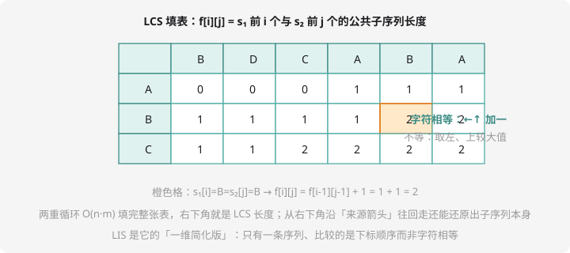

# LIS 与 LCS

## 线性 DP 的两大经典

入门篇学过「最大子段和」。本章前半场补齐线性 DP 的另外两块王牌：**最长上升子序列（LIS）**和**最长公共子序列（LCS）**——它们是区间 DP、树形 DP 的共同地基。

## LIS：最长上升子序列

> 子序列：**不要求连续**，保持原顺序挑出的若干元素（第 3 章「回文判断」就用过）。

**状态**：`f[i]` = 以第 i 个数**结尾**的 LIS 长度。

**转移**：第 i 个数接在谁后面？——接在所有「比 a[i] 小」的结尾后面，取最长的：

$$f[i] = \max_{j < i,\ a[j] < a[i]} (f[j] + 1)$$

边界 `f[i] = 1`（自己单干），答案 = 所有 f 的最大值。双重循环 $O(n^2)$，和最大子段和如出一辙。

## LCS：最长公共子序列



两条序列 s₁、s₂，找「都按顺序出现」的最长公共子序列。

**状态**：`f[i][j]` = s₁ 前 i 个与 s₂ 前 j 个的 LCS 长度。

**转移**（对二维 DP，从**最后一个字符**切入）：

- `s₁[i] == s₂[j]`：这对字符可以同时收进 LCS → `f[i][j] = f[i-1][j-1] + 1`
- 不等：至少有一个不进 → `f[i][j] = max(f[i-1][j], f[i][j-1])`

边界：`f[0][j] = f[i][0] = 0`（空串没有公共部分）。

## 例题 1：合唱队形

> **题目描述**　$n$ 位同学站成一排，身高为 $h_i$。要求出「最多的同学数」，使得留下来的人呈**合唱队形**：先严格升高、到某个峰顶后再严格降低（山顶可以只有一侧）。
>
> **输入格式**　第一行一个整数 $n$；第二行 $n$ 个整数。
>
> **输出格式**　一个整数（= $n$ − 需要出列的最少人数）。
>
> **数据范围**　$1 \le n \le 1000$，身高 $1 \sim 1000$。
>
> **样例输入 / 样例输出**
>
> ```text
> 8
> 186 186 150 200 160 130 197 220
> ```
>
> ```text
> 4
> ```

**思路分析**　合唱队形 = 一段 LIS + 一段「从峰顶出发的 LIS」（倒着看的 LIS）。对每个位置 $k$ 算两个量：`L[k]` = 以 k 结尾的 LIS 长度、`R[k]` = 以 k 开头（从右往左做 LIS）的长度。答案 = $\max_k (L[k] + R[k] - 1)$（峰顶被算两次，减一）。样例的最优峰顶是 200：左边 150、186？（严格上升——两个 186 只能留一个，取 150）→ `150 200 160 130` 长 4。✅

**参考代码**

```cpp
#include <iostream>
using namespace std;

int h[1005], L[1005], R[1005];

int main() {
    int n;
    cin >> n;
    for (int i = 1; i <= n; i++) cin >> h[i];

    for (int i = 1; i <= n; i++) {           // 从左往右：LIS
        L[i] = 1;
        for (int j = 1; j < i; j++)
            if (h[j] < h[i]) L[i] = max(L[i], L[j] + 1);
    }
    for (int i = n; i >= 1; i--) {           // 从右往左：再来一遍
        R[i] = 1;
        for (int j = n; j > i; j--)
            if (h[j] < h[i]) R[i] = max(R[i], R[j] + 1);
    }

    int ans = 0;
    for (int k = 1; k <= n; k++)
        ans = max(ans, L[k] + R[k] - 1);
    cout << n - ans << endl;
    return 0;
}
```

这就是洛谷 [P1091 合唱队形](https://www.luogu.com.cn/problem/P1091)（NOIP2004 提高 T1）。同款题还有 [P1020 导弹拦截](https://www.luogu.com.cn/problem/P1020)（LIS 的两问变体）。

## 例题 2：LCS 模板

> **题目描述**　读入两个字符串 $s_1$、$s_2$，输出它们最长公共子序列的长度。
>
> **输入格式**　两行，各一个字符串（长度 $\le 1000$）。
>
> **输出格式**　一个整数。
>
> **数据范围**　字符为大小写字母与数字。
>
> **样例输入 / 样例输出**
>
> ```text
> ABCBDAB
> BDCABA
> ```
>
> ```text
> 4
> ```

**思路分析**　教科书例子：LCS = `BCBA` 或 `BDAB`，长 4。代码就是填表三件套：相等走对角 +1、不等取左上较大。

**参考代码**

```cpp
#include <iostream>
#include <string>
using namespace std;

int f[1005][1005];

int main() {
    string s1, s2;
    cin >> s1 >> s2;
    int n = s1.size(), m = s2.size();
    for (int i = 1; i <= n; i++)
        for (int j = 1; j <= m; j++) {
            if (s1[i-1] == s2[j-1])
                f[i][j] = f[i-1][j-1] + 1;              // 对角 +1
            else
                f[i][j] = max(f[i-1][j], f[i][j-1]);    // 左 vs 上
        }
    cout << f[n][m] << endl;
    return 0;
}
```

洛谷 [P1439 LCS 模板](https://www.luogu.com.cn/problem/P1439) 数据到 $10^5$，$O(nm)$ 填表超时——它的正解是「LCS 转 LIS」（映射成下标后求 LIS，配合二分），学有余力研究。

## 进阶预告：LIS 的 $O(n \log n)$

维护数组 `g`：`g[k]` = 长度为 k 的上升子序列「结尾最小值」。每来一个数二分查找它该放的位置（`lower_bound`）——放得下就放，放不下就**挤走**那个更大的。直觉：结尾越小，后面接得越宽。总复杂度 $O(n \log n)$，$n = 10^5$ 级 LIS 题的正解。

## 动手试一试

1. 手推样例的 L、R 数组每个值，验证答案 4
2. LIS 要求**不下降**（允许相等）改哪个符号？LCS 求最短公共超序列怎么倒推？
3. 求出样例的一个具体 LCS（提示：从 f[7][6] 倒走，相等格走对角并记下字符）
4. 挑战：P1439 的「LCS 转 LIS」——先把 s₁ 的每个字符映射成它的下标，s₂ 转换成下标序列，然后求 LIS（想想为什么这样是等价的）

---

下一课：把「合并相邻」玩成艺术——[区间 DP](interval-dp.md)。
