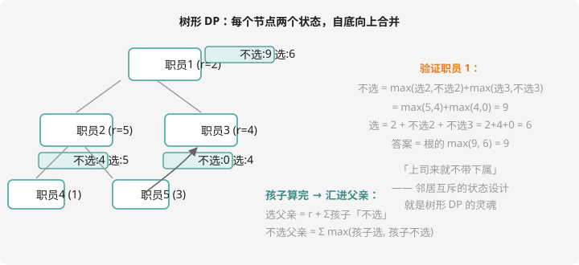

# 树形 DP

## 树上的 DP：DFS 就是计算顺序

之前的 DP 沿数组顺序、拓扑序转移；**树形 DP** 的计算顺序天然由**DFS 的递归结构**给出——「孩子的状态先算完，父亲才能转移」，正是第 11 章说的「自底向上」（对照拓扑排序：树是最简单的 DAG）。

通用骨架：DFS 到节点 u → 先递归所有孩子 → 用孩子的 f 值更新自己。

```cpp
void dfs(int u, int parent) {          // parent 防止走回父亲
    for (int v : adj[u]) {
        if (v == parent) continue;
        dfs(v, u);                     // 先算孩子
        // 用 f[v] 转移到 f[u]
    }
    // 此处 f[u] 已就绪
}
```

## 状态设计的灵魂：互斥

树形 DP 状态常见的形状是 `f[u][0/1]`——**u 自己选不选**。之所以分两态，是因为存在「邻居互斥」类约束（选了父亲就不能选孩子）。**约束写到状态里，转移才有方向。**

## 经典例题：没有上司的舞会



> **题目描述**　某单位的人事关系组成一棵树（根为总负责人，直接下属为儿子）。每个人有一个「快乐指数」$r_i$。现在开年会，**任何人不能和自己的直接上司同时出席**。求与会人员快乐指数总和的最大值。
>
> **输入格式**　第一行一个整数 $n$；第二行 $n$ 个整数 $r_i$；接下来 $n-1$ 行每行 `l k`，表示 k 是 l 的直接上司（最后一行给根，保证是一棵树）。
>
> **输出格式**　一个整数。
>
> **数据范围**　$1 \le n \le 6000$，快乐指数 $-128 \sim 127$。
>
> **样例输入 / 样例输出**
>
> ```text
> 5
> 2 5 4 1 3
> 2 1
> 3 1
> 4 2
> 5 2
> ```
>
> ```text
> 9
> ```

**思路分析**　样例的树：1 是根（r=2），下属 2（r=5）、3（r=4）；2 的下属 4（r=1）、5（r=3）。

**状态**：`f[u][0]` = u 不出席时子树的最大快乐和；`f[u][1]` = u 出席时的最大快乐和。

**转移**（第 11 章「自底向上」落地）：

- 选 u（`f[u][1] = r[u] + Σ f[v][0]`）：下属全不能来
- 不选 u（`f[u][0] = Σ max(f[v][0], f[v][1])`）：下属爱来不来

**答案**：`max(f[root][0], f[root][1])`。

**参考代码**

```cpp
#include <iostream>
#include <vector>
using namespace std;

vector<int> adj[6005];
long long f[6005][2];
int r[6005];
bool hasBoss[6005];

void dfs(int u) {
    f[u][1] = r[u];                    // 选自己：先算上自己的快乐
    for (int v : adj[u]) {
        dfs(v);                        // 递归孩子（自底向上）
        f[u][1] += f[v][0];            // 选 u → 孩子必不选
        f[u][0] += max(f[v][0], f[v][1]);  // 不选 → 孩子取大
    }
}

int main() {
    int n;
    cin >> n;
    for (int i = 1; i <= n; i++) cin >> r[i];
    for (int i = 1; i < n; i++) {
        int l, k;
        cin >> l >> k;
        adj[k].push_back(l);           // k 是 l 的上司：边 k → l
        hasBoss[l] = true;
    }
    int root = 1;
    for (int i = 1; i <= n; i++)
        if (!hasBoss[i]) root = i;     // 找根（没有上司的那个）

    dfs(root);
    cout << max(f[root][0], f[root][1]) << endl;
    return 0;
}
```

这就是洛谷 [P1352 没有上司的舞会](https://www.luogu.com.cn/problem/P1352)——树形 DP 的第一道必做题。

**验证样例**：`f[4][1]=1, f[4][0]=0`；`f[5][1]=3, f[5][0]=0`；`f[2][1]=5+0+0=5, f[2][0]=max(0,1)+max(0,3)=4`；`f[3][1]=4, f[3][0]=0`；`f[1][1]=2+4+0=6, f[1][0]=max(4,5)+max(0,4)=9`。答案 $\max(6, 9) = 9$ ✅（不请老板，请 2 和 3）。

## 树上背包（预告 + 直觉）

更进阶的形态：选了课程 u 才能选它的先修课 v——**树 + 背包**。状态多一维 `f[u][j]`（u 子树里花 j 个容量），转移是「分组背包」式的两重循环合并每棵子树：

```cpp
for (int v : adj[u]) {          // 逐棵子树合并（贪心? 不！是分组背包思想）
    dfs(v);
    for (int j = m; j >= 0; j--)            // 类似 01 背包倒序！
        for (int k = 0; k <= j; k++)
            f[u][j] = max(f[u][j], f[u][j-k] + f[v][k]);
}
```

倒序循环防重复——和第 8 章 01 背包一模一样的道理。这就是洛谷 [P2014 选课](https://www.luogu.com.cn/problem/P2014)，CSP-S 树形背包的代表题，代码框架建议收藏。

## 树形 DP 的常见清单

| 问题 | 状态形状 |
| ---- | ---- |
| 舞会/依赖选择 | `f[u][0/1]` |
| 树上背包 | `f[u][j]` |
| 树的直径 | `f[u]` = u 向下最长链，拼接更新答案 |
| 最大子树和 | `f[u]` = u 子树最大贡献（可剪枝负贡献） |

## 动手试一试

1. 手模样例：写出 5 个节点各自的 f[u][0]、f[u][1]，对照代码
2. 变体：改为「上司和下属**必须**恰好出席一人」（非根），转移怎么改？（提示：f[u][1] = r[u] + Σf[v][0] 与 f[u][0] = Σf[v][1]——两态都强制）
3. 最大子树和：n 个点带权（可负），选一个连通子集权和最大（洛谷 P2585? 搜「最大子树和」）——负贡献的孩子直接「剪枝」不选
4. 挑战：P2014 选课——m 门课容量、先修关系成森林（加虚拟根转成树），输出最多学分

---

下一课：状态压缩成二进制——[状压 DP](bitmask-dp.md)。
