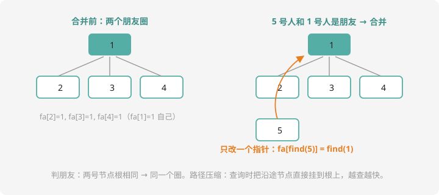

# 并查集

## 一类新问题：「谁和谁是一伙的」

社交网络里，朋友的朋友也算朋友（朋友关系会传递）。不停地「A 和 B 成为朋友」，反复问「X 和 Y 是不是一伙的」——用数组、栈、队列都别扭，**并查集（DSU）**是为这类「分组 + 合并 + 查询」问题量身定做的结构。

三个基本操作：

- `find(x)`：x 属于哪个组？（返回组的**代表**）
- `union(a, b)`：把 a、b 所在两组合并成一组
- 查询：`find(x) == find(y)` 则同组

## 核心机制：每组的「族谱树」

每组组织成一棵树：**每个节点记着自己的父节点**，根就是组的代表。`fa[i] = i` 表示 i 自己就是根。



## 代码实现（15 行的强大）

```cpp
#include <iostream>
using namespace std;

int fa[10005];

void init(int n) {
    for (int i = 1; i <= n; i++) fa[i] = i;   // 每人自成一派
}

int find(int x) {
    if (fa[x] == x) return x;       // 根的 fa 是自己
    return find(fa[x]);             // 顺着族谱往上找
}

void merge(int a, int b) {
    fa[find(a)] = find(b);          // a 组的根认 b 组的根做爸
}

int main() {
    int n, m;
    cin >> n >> m;
    init(n);
    while (m--) {
        int op, x, y;
        cin >> op >> x >> y;
        if (op == 1) merge(x, y);
        else cout << (find(x) == find(y) ? "Y" : "N") << endl;
    }
    return 0;
}
```

`merge` 只改一个指针：让 a 组的根认 b 组的根做父亲——两棵树变成一棵（对照图右，5 号挂进 1 号的树）。

## 路径压缩：越查越快的魔法

最坏情形：树退化成一条长链，`find` 要爬 $O(n)$ 层。**路径压缩**：find 的时候顺手把沿途所有节点**直接挂到根上**——第一次走完长链后，大家的父都变成根，之后再查就是一步到位：

```cpp
int find(int x) {
    if (fa[x] == x) return x;
    return fa[x] = find(fa[x]);   // 递归找根的同时，fa[x] 直接改成根
}
```

一行改动（`fa[x] = find(fa[x])`，赋值和返回一气呵成），复杂度降到近似 $O(1)$（准确说均摊 $O(\alpha(n))$，反阿克曼函数，可视为常数）。**竞赛中路径压缩是标配，不写就是给自己埋雷。**

## 数组的两种妙用

**① 统计组的个数**：数一数有多少个 `fa[i] == i` 的根——每个根代表一个组。经典应用「连通块计数」：图上每读入一条边就 merge 两个端点，最后数根。

**② 带权并查集（认识）**：在 `fa` 之外再记一个「到根的距离/相对关系」，能处理「A 比 B 大 3 岁」这类带数值的关系传递——CSP-S 提高进一步会用到，先知道有这东西。

## 例题：亲戚

> **题目描述**　若 A 是 B 的（外）祖父、父亲、儿子、兄弟……则称 A 与 B 有亲戚关系（关系可传递：A 是 B 的亲戚，B 是 C 的亲戚 ⇒ A 是 C 的亲戚）。给出若干条亲戚关系，回答若干次询问。
>
> **输入格式**　第一行 $n, m, p$（人数、关系数、询问数）。接下来 $m$ 行每行两个数表示亲戚关系；接下来 $p$ 行每行两个数表示询问。
>
> **输出格式**　每个询问输出 `Yes` 或 `No`。
>
> **数据范围**　$1 \le n, m, p \le 5000$。
>
> **样例输入 / 样例输出**
>
> ```text
> 6 5 3
> 1 2
> 1 5
> 3 4
> 5 2
> 3 6
> 1 6
> 1 3
> 2 4
> ```
>
> ```text
> Yes
> No
> No
> ```

**思路分析**　亲戚关系**可传递**——一句话点明并查集适配：把「有亲戚关系的」merge 进同一组，询问就是查根。样例里 1-2、1-5、5-2 都并进 1 组；3、4、6 是另一组。`1 6` 跨组 → No。

**参考代码**

```cpp
#include <iostream>
using namespace std;

int fa[5005];

int find(int x) {
    if (fa[x] == x) return x;
    return fa[x] = find(fa[x]);   // 路径压缩
}

void merge(int a, int b) {
    fa[find(a)] = find(b);
}

int main() {
    int n, m, p;
    cin >> n >> m >> p;
    for (int i = 1; i <= n; i++) fa[i] = i;
    for (int i = 0; i < m; i++) {
        int a, b;
        cin >> a >> b;
        merge(a, b);
    }
    for (int i = 0; i < p; i++) {
        int a, b;
        cin >> a >> b;
        cout << (find(a) == find(b) ? "Yes" : "No") << endl;
    }
    return 0;
}
```

这就是洛谷 [P1551 亲戚](https://www.luogu.com.cn/problem/P1551)——并查集的入门试金石。

## 什么时候想到并查集？

看到这几个信号就上 DSU：

- 关系**可传递**（朋友、亲戚、连通、同类）
- 只有「合并」没有「拆分」（拆组 DSU 做不了，要退树/线段树）
- 反复问「是否同组」「有几组」

第 11 章图论里，**Kruskal 最小生成树靠它判环**、连通性问题靠它加速——这 15 行代码是提高篇出场率最高的工具之一。

## 动手试一试

1. 手模：1~5 号，依次 merge(1,2)、merge(3,4)、merge(2,3)、merge(5,4)，画出每步的树，回答 find(1) 和 find(5) 相同吗？
2. 连通块计数：$n$ 个点 $m$ 条边的图，用并查集输出连通块个数（数根的个数即可）
3. 食物链预告（POJ 经典，拓展）：A 吃 B、B 吃 C、C 吃 A 的循环关系，普通并查集存不了「三类」——想想为什么？（提示：需要带权/扩展域）
4. 思考：merge 时把「小树挂到大树下」（按秩合并）有什么好处？和路径压缩能同时用吗？

---

下一课：字符串的两把快刀——[哈希表与字典树](hash-trie.md)。
