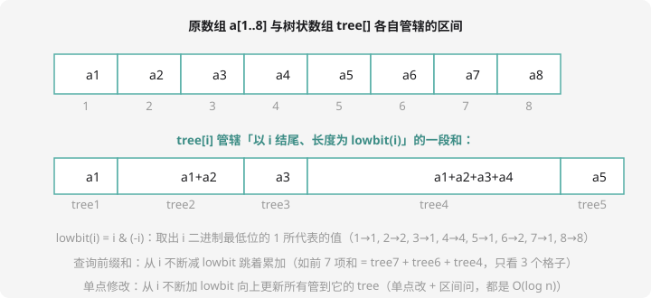

# 树状数组与线段树

## 一类高频需求：边改边问区间和

数列 $a_1 \ldots a_n$，两种操作反复交错：**改某一项**；**问某一段的和**。

| 方案 | 单点修改 | 区间求和 | 一起 m 次 |
| ---- | :--: | :--: | :--: |
| 暴力数组 | $O(1)$ | $O(n)$ | $O(nm)$ ❌ |
| 前缀和数组 | $O(n)$ 改后重建 | $O(1)$ | ❌ |
| **树状数组 / 线段树** | $O(\log n)$ | $O(\log n)$ | ✅ |

暴力在前缀和面前总有一边拖后腿。**树状数组（Fenwick Tree）和线段树**两个都要快——CSP-S 第二轮的常客。

## 树状数组：下标二进制分层的智慧

核心思路：把前缀和拆成若干「分层块」，`tree[i]` 专门管辖「以 i 结尾、长度为 lowbit(i)」的一段：



`lowbit(i) = i & (-i)`：取出 i 二进制最低位的 1（比如 6=`110` → lowbit=2）。每段长度 $2^k$——下标的二进制形状直接决定了管辖范围，数组即可存储，无需真正建树。

### 两个操作，各两三行

**查询前缀和**（1~i 的和）：从 i 出发，不断减 lowbit 跳着累加。如前 7 项和 = `tree[7] + tree[6] + tree[4]`（7→6→4→0，只碰 3 个格子——这就是 $\log n$）。

```cpp
long long query(int i) {
    long long s = 0;
    for (; i > 0; i -= i & (-i)) s += tree[i];
    return s;
}
```

**单点修改**（a[i] += v）：所有管辖 i 的 tree 都要更新——从 i 出发**不断加 lowbit** 向上走：

```cpp
void update(int i, long long v) {
    for (; i <= n; i += i & (-i)) tree[i] += v;
}
```

区间和 `sum(l, r) = query(r) - query(l-1)`。**减 lowbit 向下查询、加 lowbit 向上修改**——一个 lowbit，两个方向，树状数组的全部。

### 例题：单点修改，区间求和

> **题目描述**　$n$ 个数的数列，$m$ 次操作：`1 x v` 表示把 $a_x$ 加上 $v$；`2 l r` 表示求 $a_l + \cdots + a_r$。
>
> **输入格式**　第一行 $n, m$；第二行 $n$ 个数；接下来 $m$ 行每行一条操作。
>
> **输出格式**　每条操作 2 输出一行结果。
>
> **数据范围**　$1 \le n, m \le 10^6$，$|a_i|, |v| \le 10^5$，和可能超 int。
>
> **样例输入 / 样例输出**
>
> ```text
> 5 4
> 1 2 3 4 5
> 2 1 4
> 1 3 10
> 2 1 4
> 2 3 5
> ```
>
> ```text
> 10
> 20
> 22
> ```

**思路分析**　模板题：初始把每个数 `update` 一遍建树；操作 2 用两次 query 作差。验算样例：初始 `2 1 4` = 1+2+3+4 = 10 ✅；第三条操作 `1 3 10` 是「**加上** 10」，$a_3$ 从 3 变 13；`2 1 4` = 1+2+13+4 = 20 ✅；`2 3 5` = 13+4+5 = **22** ✅。注意 `1 x v` 是「加上 v」不是「赋值为 v」——读题再细一步。

**参考代码**

```cpp
#include <iostream>
using namespace std;

long long tree[1000005];
int n, m;

void update(int i, long long v) {
    for (; i <= n; i += i & (-i)) tree[i] += v;
}

long long query(int i) {
    long long s = 0;
    for (; i > 0; i -= i & (-i)) s += tree[i];
    return s;
}

int main() {
    ios::sync_with_stdio(false);
    cin.tie(nullptr);
    cin >> n >> m;
    for (int i = 1; i <= n; i++) {
        long long a;
        cin >> a;
        update(i, a);
    }
    while (m--) {
        int op, x;
        long long y;
        cin >> op >> x >> y;
        if (op == 1) update(x, y);
        else cout << query(y) - query(x - 1) << "\n";
    }
    return 0;
}
```

这就是洛谷 [P3374 【模板】树状数组 1](https://www.luogu.com.cn/problem/P3374)——数据 $10^6$ 级，暴力必挂，树状数组 1 秒内过。

## 线段树：更通用的区间神器

树状数组只能做「前缀可减」的和类运算。**线段树（Segment Tree）**把区间对半分叉成二叉树，每个节点管一个区间、区间信息（和/最值）由两个孩子**合并**上来：

- 查询 $[l, r]$：拆成 $O(\log n)$ 个节点拼出答案——**max/min 也适用**（减法不成立的场景它照赢）
- 区间修改（某段整体加 v）：**懒标记（lazy tag）**先记账、用到再下传

代价是代码量大得多（建树、查询、修改、下传四个函数，百行级）。策略建议：

> **能用树状数组（求和类）就用树状数组；要最值 / 区间赋值 / 复杂合并才上线段树。**线段树建议先理解思想、背熟一份自己的模板，第 14 章结合具体题再深入。

## 三兄弟定位

| 结构 | 擅长 | 代码量 |
| ---- | ---- | :--: |
| 前缀和数组 | 静态区间和（不改） | 5 行 |
| 树状数组 | 动态前缀和（可减信息） | 15 行 |
| 线段树 | 任意区间信息的修改与查询 | 100 行 |

## 动手试一试

1. 手算：lowbit(12)、lowbit(7)、lowbit(20)（提示：转二进制看最低位 1）
2. 模拟前 7 项和的查询路径：为什么是 tree7 + tree6 + tree4？画 7→6→4 的跳转图
3. 改造 P3374：支持 `3 x` 查询 $a_x$ 的当前值（提示：query(x) - query(x-1)）
4. 挑战：逆序对问题——从左往右扫描，每个数贡献「它前面比它大的数的个数」。值域树状数组 + 倒着插入就能 O(n log n) 求出总逆序对（洛谷 P1904 系列有模板题，提高篇核心练习）

---

下一章，提高篇的重头戏：[第 11 章 · 树与图论](../graph/index.md)。
