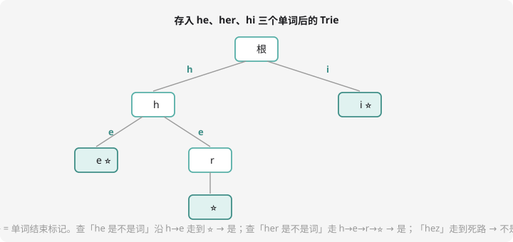

# 哈希表与字典树

两个处理「存与查」的工具：**哈希表**把任何东西变成下标，**字典树**按字符逐层组织字符串。它们不冲突，按场景选。

## 哈希表：值变下标，一步到位

第 3 章的桶计数其实就是哈希思想的雏形：数字是几就丢进几号桶，`cnt[x]++` 一步到位。但桶有个致命限制——**下标必须是小整数**。如果是字符串、大数、甚至坐标对呢？

**哈希函数**登场：把任意东西映射成 0~M-1 的下标。字符串常用「多项式哈希」：

$$hash(s) = \left(\sum s_i \times B^i\right) \bmod M$$

好比把字符串当成一个 $B$ 进制数再对 $M$ 取模——不同的串几乎必然得到不同下标。

### 冲突：哈希绕不开的问题

两个不同的串可能算出同一个下标——**冲突**。最常用的对策：**拉链法**，每个下标挂一条链表，冲突的都串上去。查询时算出下标、沿着链逐个比对。

竞赛实操建议：手写哈希表费时，直接用 STL 两兄弟——

```cpp
#include <map>
#include <unordered_map>
map<string, int> m;               // 红黑树，有序，O(log n)
unordered_map<string, int> um;    // 哈希表，无序，平均 O(1)
m["apple"]++;                     // 两种都这样用
```

- `map`：稳定 $O(\log n)$，key 自动排序（能按序遍历、二分）
- `unordered_map`：平均 $O(1)$，快但怕被特殊数据卡（竞赛里偶尔被出题人针对，卡了换 map 或换哈希种子）

**口诀：要有序用 map，要快用 unordered_map，怕卡就 map。**

## 字典树：字符串的家谱

要存大量字符串并回答「某词在不在？以 xx 开头的有几个？」——哈希表能答「在不在」，答不了**前缀**类问题。**字典树（Trie）**按字符逐层分叉组织所有词：



观察三个特点：

1. **公共前缀共用路径**——`he`、`her`、`hi` 共享 `h`，省空间还天然支持前缀查询
2. 节点不存字符，**边上才是字符**；节点本身是「前缀到此为止」的标记
3. **⭐ 结束标记**必不可少：`he` 是单词，但它是 `her` 的前缀——没有标记就没法区分「走通了」和「真是词」

## Trie 的数组实现

Trie 节点的孩子最多 26 个（小写字母），用二维数组 `ch[节点][字符]`：

```cpp
#include <iostream>
#include <string>
using namespace std;

int ch[1000005][26];   // ch[u][c]：u 号节点走字符 c 去的节点编号（0 = 不存在）
bool endMark[1000005]; // 是否有单词在此结束
int tot = 0;           // 已用节点数（0 号保留给根）

void insert(const string& s) {
    int u = 0;
    for (char c : s) {
        int k = c - 'a';
        if (!ch[u][k]) ch[u][k] = ++tot;   // 没有这条边就新建节点
        u = ch[u][k];
    }
    endMark[u] = true;
}

bool find(const string& s) {
    int u = 0;
    for (char c : s) {
        int k = c - 'a';
        if (!ch[u][k]) return false;       // 死路：不是任何词的前缀
        u = ch[u][k];
    }
    return endMark[u];                     // 走通了还得确认是词不是前缀
}
```

插入、查询单词都是 $O(\text{单词长度})$——与词典大小无关，这正是 Trie 的价值。

## 例题：前缀统计

> **题目描述**　给出 $n$ 个字符串，再给 $q$ 个询问：每个询问给一个字符串 $t$，问这 $n$ 个字符串里有多少个**是 $t$ 的前缀**（包括 $t$ 自己）。
>
> **输入格式**　第一行 $n, q$；接下来 $n$ 行每行一个字符串；接下来 $q$ 行每行一个询问串。
>
> **输出格式**　$q$ 行，每行一个整数。
>
> **数据范围**　字符串仅小写字母，总长 $\le 10^6$。
>
> **样例输入 / 样例输出**
>
> ```text
> 3 2
> a
> ab
> abc
> ab
> abc
> ```
>
> ```text
> 2
> 3
> ```

**思路分析**　「是 $t$ 的前缀的词」在 Trie 上的位置：从根沿 $t$ 的字符走，**沿途所有 ⭐ 的个数**。所以插入时不止打结束标记，还要记个 `cnt[u]`（有几个单词结束在此节点），查询沿路累加即可。

**参考代码**

```cpp
#include <iostream>
#include <string>
using namespace std;

int ch[1000005][26];
int cnt[1000005];      // 有几个单词结束在这个节点
int tot = 0;

void insert(const string& s) {
    int u = 0;
    for (char c : s) {
        int k = c - 'a';
        if (!ch[u][k]) ch[u][k] = ++tot;
        u = ch[u][k];
    }
    cnt[u]++;
}

int query(const string& t) {
    int u = 0, ans = 0;
    for (char c : t) {
        int k = c - 'a';
        if (!ch[u][k]) break;      // 走死路：后面不可能再有前缀了
        u = ch[u][k];
        ans += cnt[u];             // 沿途每个结束点都是一个前缀词
    }
    return ans;
}

int main() {
    ios::sync_with_stdio(false);   // 数据量大，关流加速
    cin.tie(nullptr);
    int n, q;
    cin >> n >> q;
    string s;
    for (int i = 0; i < n; i++) { cin >> s; insert(s); }
    for (int i = 0; i < q; i++) { cin >> s; cout << query(s) << "\n"; }
    return 0;
}
```

同款题：洛谷 [P8306 字典树](https://www.luogu.com.cn/problem/P8306)（问的是「以某前缀开头的有几个」——把 cnt 挪到「经过次数」即可，一念之转）。

## 什么时候用谁？

| 需求 | 工具 |
| ---- | ---- |
| 在不在 / 计数（不管前缀） | `unordered_map` / `map` |
| 前缀查询、按字典序遍历、自动补全 | Trie |
| 一堆整数判重（值域大） | 哈希 / 排序后扫 |
| 字符串匹配找模式串 | 下一章的 KMP |

## 动手试一试

1. 用 `map<string,int>` 统计一段文字里每个单词出现次数并按字典序输出（遍历 map 天然有序——想想为什么这正是 map 的价值）
2. 给 Trie 的节点加 `pass[u]`（经过次数），实现「以 s 为前缀的词有几个」
3. 手画：插入 `to`, `tea`, `ten`, `in` 后的 Trie（14 个节点以内），标出所有 ⭐
4. 思考：Trie 存 100 万个英文单词，最坏要多少节点？（每个单词 20 字母、无公共前缀 → 2000 万节点——内存约 2000 万 × 26 × 4 字节 ≈ 2GB！所以大数据要用 `unordered_map` 版 Trie 或双数组 Trie，先知道有内存危机）

---

下一课：区间求和的快刀手——[树状数组与线段树](fenwick-segment.md)。
