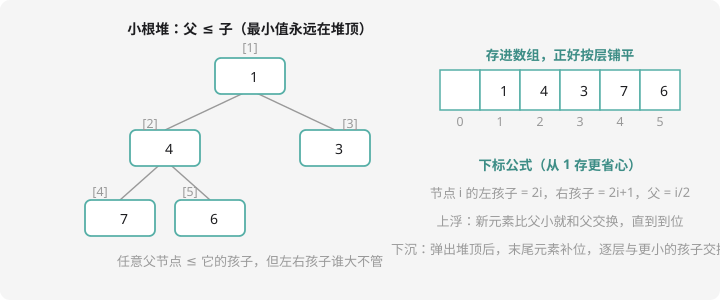

# 堆与优先队列

## 堆：专为「取最值」而生的结构

反复遇到这类需求：一堆数里反复取最小值、取完还会插入新数。排序一遍要 $O(n \log n)$，每次插入再排序不可接受。**堆（heap）**为此而生：

| 操作 | 复杂度 |
| ---- | :--: |
| 取最小值（小根堆堆顶） | $O(1)$ |
| 插入一个数 | $O(\log n)$ |
| 删除最小值 | $O(\log n)$ |

## 堆的结构：半成品的排序树

**堆是一棵完全二叉树**（除最后一层外全满，最后一层从左到右排），且满足**父 ≤ 子**（小根堆）——注意只保证「父小」，**左右孩子谁大不管**。所以它不是排序好的，但最小值一定在堆顶。



完全二叉树有个绝妙性质：**用数组就能存**（不留空洞）——节点 `i` 的左孩子 `2i`、右孩子 `2i+1`、父亲 `i/2`。指针都省了。

## 两个核心操作

**上浮（插入后用）**：新元素放末尾，比父小就和父交换，一路上浮到位置合法：

```cpp
void push(int x) {
    heap[++len] = x;
    int i = len;
    while (i > 1 && heap[i] < heap[i / 2]) {
        swap(heap[i], heap[i / 2]);
        i /= 2;
    }
}
```

**下沉（删除堆顶后用）**：堆顶弹出后，把**最后一个元素**搬到堆顶补位，然后逐层和「较小的那个孩子」交换下沉：

```cpp
void pop() {
    heap[1] = heap[len--];
    int i = 1;
    while (2 * i <= len) {                 // 有孩子就继续
        int son = 2 * i;                    // 先指向左孩子
        if (son + 1 <= len && heap[son + 1] < heap[son])
            son++;                          // 右孩子更小就选右
        if (heap[son] < heap[i]) {
            swap(heap[i], heap[son]);
            i = son;
        } else break;
    }
}
```

两个操作都沿树**走一条链**，最多 $\log n$ 层——这就是 $O(\log n)$ 的来源。

## STL 优先队列：考场版

C++ 自带 `priority_queue`（底层就是堆），考场直接用：

```cpp
#include <queue>
priority_queue<int> q;                          // 大根堆（默认）
priority_queue<int, vector<int>, greater<int>> pq;   // 小根堆

pq.push(3);  pq.push(1);  pq.push(4);
pq.top();     // 小根堆：最小值 1（大根堆用 top() 取最大）
pq.pop();     // 删除堆顶
```

注意三点：默认是**大根堆**；小根堆那串模板参数要背；`top()` 只看不删，`pop()` 删但返回 void——**取值必须赶在 pop 之前**。

## 例题：合并果子

> **题目描述**　$n$ 堆果子，每次可以把任意两堆合并成一堆，代价为两堆重量之和。把所有果子合成一堆，最小总代价是多少？
>
> **输入格式**　第一行一个整数 $n$；第二行 $n$ 个整数，表示每堆重量。
>
> **输出格式**　一个整数。
>
> **数据范围**　$1 \le n \le 10000$，每堆重量 $\le 10^5$，答案可能超 int。
>
> **样例输入 / 样例输出**
>
> ```text
> 4
> 1 2 3 4
> ```
>
> ```text
> 19
> ```

**思路分析**　先想策略：每次都拿**最小的两堆**合并（贪心！小的数被加的次数越多总代价越小——小的应该早合并、晚参与）。为什么这里是安全的贪心？合并次数固定 $n-1$ 次，越小的堆参与合并的次数越多，总代价越小（Huffman 树思想）。

流程：小根堆取两个最小 → 合并代价累加 → 新堆放回堆里 → 重复 $n-1$ 次。堆恰好完美匹配「反复取最小 + 插入新值」——**贪心定策略，堆做引擎**。

**参考代码**

```cpp
#include <iostream>
#include <queue>
#include <vector>
using namespace std;

int main() {
    int n;
    cin >> n;
    priority_queue<long long, vector<long long>, greater<long long>> pq;  // 小根堆
    for (int i = 0; i < n; i++) {
        long long x;
        cin >> x;
        pq.push(x);
    }

    long long total = 0;
    while (pq.size() > 1) {
        long long a = pq.top(); pq.pop();   // 最小
        long long b = pq.top(); pq.pop();   // 次小
        total += a + b;                     // 本次合并代价
        pq.push(a + b);                     // 新堆入队
    }
    cout << total << endl;
    return 0;
}
```

拿样例走一遍：`(1,2,3,4)` → 合 1+2=3 → `(3,3,4)` → 合 3+3=6 → `(4,6)` → 合 4+6=10 → 总代价 $3+6+10=19$。✅

这就是洛谷 [P1090 合并果子](https://www.luogu.com.cn/problem/P1090)，NOIP2004 提高 T2——「贪心 + 堆」组合的经典。试试用第 5 章的排序写法对比：每次合并后重新排序会超时，堆的 $O(n \log n)$ 稳过。

## 动手试一试

1. 手画：依次 push 5、2、7、1 到小根堆，画出每步的树形
2. Top-K 问题：100 亿个数找最大的 10 个（内存装不下！）——用**大小为 10 的小根堆**流式处理，想想为什么是小根堆
3. SLF 队列（拓展）：双端队列 BFS 预告——`deque` 是什么？跟 `queue` 差在哪？
4. 挑战：用 `priority_queue` 重写第 5 章「排队接水」，体会堆替代排序的场景

---

下一课：朋友圈管理专家——[并查集](dsu.md)。
