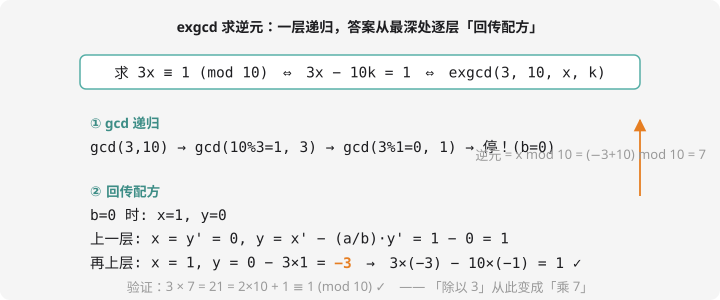

# 扩展欧几里得与逆元

## 为什么「除法不能取模」是问题

$(a \times b) \bmod p$ 可以逐层取模，但 $\frac{a}{b} \bmod p$ 不能先除——比如 $6 / 3 = 2$，可 $(6 \bmod 5) / (3 \bmod 5) = 1/3$？数都除不尽了。

组合数 $C_n^m = \frac{n!}{m!(n-m)!}$ 是除法的重灾区，而「组合数取模」又是 CSP-S 的常客。解法：**把除法翻译成乘法**——找一个 $b^{-1}$ 使 $b \times b^{-1} \equiv 1 \pmod p$，这个 $b^{-1}$ 叫 **b 的逆元**（记作 $inv(b)$）。于是：

$$\frac{a}{b} \bmod p = a \times inv(b) \bmod p$$

类比：模 10 世界里 $inv(3) = 7$，因为 $3 \times 7 = 21 \equiv 1$。「除以 3」从此写成「乘 7」。

## 扩展欧几里得（exgcd）：逆元的第一把钥匙

$inv(b)$ 存在的等价条件：$b \times x \equiv 1 \pmod p$ 有解 ⇔ 存在整数 $x, y$ 使

$$b \cdot x + p \cdot y = \gcd(b, p) = 1 \quad (\gcd(b,p)=1 \text{ 即互质})$$

**求解 $bx + py = \gcd(b,p)$ 的算法叫扩展欧几里得（exgcd）**——在第 9 章辗转相除的递归上「回传配方」：



```cpp
// 解 bx + py = gcd(b, p)，返回 gcd，x、y 以引用带回
long long exgcd(long long b, long long p, long long &x, long long &y) {
    if (p == 0) { x = 1; y = 0; return b; }     // 递归底：b×1 + 0×0 = b
    long long x1, y1;
    long long g = exgcd(p, b % p, x1, y1);      // 先解子问题
    x = y1;                                     // 回传配方（推导见图）
    y = x1 - (b / p) * y1;
    return g;
}

// 求 b 在 mod p 下的逆元（需 gcd(b,p)=1）
long long inv(long long b, long long p) {
    long long x, y;
    exgcd(b, p, x, y);
    return (x % p + p) % p;     // 修正成非负的最小解
}
```

看图走一遍 $b=3, p=10$ 的完整流程：gcd 递归到 $b=0$ 停止，配方逐层回传得 $x = -3$，修正到非负 $(−3 + 10) \bmod 10 = 7$，验证 $3 \times 7 = 21 \equiv 1$ ✅。

**「(x % p + p) % p」那句修正必须写**——exgcd 的解可能带负号，取模的减法铁律（第 15 章第一课）在这里兑现。

## 第二把钥匙：费马小定理

当 **p 是质数**（CSP 几乎都是 $10^9+7$）且 b 不是 p 的倍数时，有更短的公式：

$$b^{p-1} \equiv 1 \pmod p \quad \Rightarrow \quad inv(b) = b^{p-2} \bmod p$$

一行快速幂搞定，**考场首选**：

```cpp
long long inv(long long b, long long p) {
    return qpow(b, p - 2, p);   // 用第一课的快速幂
}
```

两把钥匙的分工：**p 是质数用费马小定理（一行），p 不保证质数用 exgcd（万能）**。考题默认 $p = 10^9+7$（质数），背费马版；笔试考「逆元存在条件」时答「互质」。

## 例题：组合数取模

> **题目描述**　读入 $n$、$m$（$0 \le m \le n \le 10^6$），输出 $C_n^m \bmod (10^9+7)$。
>
> **输入格式**　一行两个整数。
>
> **输出格式**　一个整数。
>
> **数据范围**　见上。
>
> **样例输入 / 样例输出**
>
> ```text
> 10 3
> ```
>
> ```text
> 120
> ```

**思路分析**　第 9 章的杨辉三角递推 $O(n^2)$ 在 $n = 10^6$ 下是 $10^{12}$，必挂。改用**阶乘 + 逆元**的公式法：

$$C_n^m = n! \times inv(m!) \times inv((n-m)!)$$

预处理 $10^6$ 的阶乘表和逆元表（$inv(n!) = inv((n-1)!) \times inv(n)$，或每个都费马），单次查询 $O(1)$。验证样例：$10! / (3! \cdot 7!) = 120$ ✅。

**参考代码**

```cpp
#include <iostream>
using namespace std;

const long long MOD = 1e9 + 7;
const int N = 1000006;
long long fact[N], invf[N];

long long qpow(long long a, long long b) {
    long long r = 1;
    a %= MOD;
    while (b) {
        if (b & 1) r = r * a % MOD;
        a = a * a % MOD;
        b >>= 1;
    }
    return r;
}

void init() {
    fact[0] = 1;
    for (int i = 1; i < N; i++) fact[i] = fact[i-1] * i % MOD;
    invf[N-1] = qpow(fact[N-1], MOD - 2);          // 一个逆元反推全部！
    for (int i = N - 2; i >= 0; i--) invf[i] = invf[i+1] * (i + 1) % MOD;
}

long long C(int n, int m) {
    if (m < 0 || m > n) return 0;
    return fact[n] * invf[m] % MOD * invf[n - m] % MOD;
}

int main() {
    init();
    int n, m;
    cin >> n >> m;
    cout << C(n, m) << endl;
    return 0;
}
```

注意预处理逆元表的**反推技巧**：只算一次 $inv(N!)$，然后用 $inv(i) = inv(i+1) \times (i+1)$ 倒着推全表——比每个数跑快速幂快得多。这就是洛谷 [P2822 组合数问题](https://www.luogu.com.cn/problem/P2822) 及各类计数题的地基。数论工具链到此闭环：**快速幂 → 逆元 → 组合数取模 → 各种计数 DP**。

## 动手试一试

1. 手算：$inv(3) \bmod 11$（费马：$3^9 \bmod 11$；exgcd 验证 $3 \times 4 = 12 \equiv 1$ → 答案 4）
2. 为什么「$p$ 不是质数时费马小定理失效」？举 $p=4, b=3$ 的例子（$3^2 = 9 \not\equiv 1 \pmod 4$）
3. 预处理 $inv(1..n)$ 的线性递推公式：$inv[i] = -(MOD/i) \times inv[MOD \% i] \bmod MOD$——用 $MOD = ki + r$ 代入验证一遍
4. 挑战：用本课工具重做第 12 章「组合数计算」，把 $n \le 30$ 的限制放宽到 $n \le 10^6$ 取模输出

---

下一课：对策论的第一课——[博弈论入门](game.md)。
