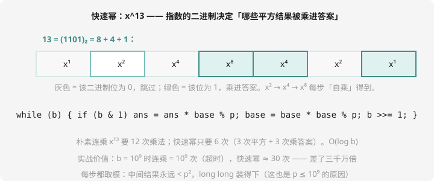

# 快速幂与取模运算

## 「到处取模」的世界

提高篇的答案动辄天文数字，题目统一要求「输出对 $10^9+7$ 取模的结果」。取模运算有四条铁律（都由 $(a \bmod p) \times (a \bmod p) \equiv a^2 \bmod p$ 这类同余性质推出）：

$$\begin{aligned}
(a + b) \bmod p &= ((a \bmod p) + (b \bmod p)) \bmod p \\
(a - b) \bmod p &= ((a - b) \bmod p + p) \bmod p \quad \text{防负数！} \\
(a \times b) \bmod p &= ((a \bmod p) \times (b \bmod p)) \bmod p \\
(a / b) \bmod p &\ne \dots \quad \text{除法不满足！要用逆元（下一课）}
\end{aligned}$$

加、减、乘都可以「随手取模」，唯独除法不能——这就是逆元存在的理由，先埋个伏笔。

## 快速幂：O(log b) 的乘方

计算 $a^b \bmod p$。朴素连乘 $b$ 次，$b = 10^9$ 直接超时。快速幂利用第 14 章的分治/倍增思想：

$$a^{13} = a^{8} \times a^{4} \times a^{1}, \quad 13 = (1101)_2$$

**指数的二进制决定哪些「平方结果」被乘进答案**：



```cpp
long long qpow(long long a, long long b, long long p) {
    long long ans = 1;
    a %= p;
    while (b) {
        if (b & 1) ans = ans * a % p;   // 该位是 1：乘进答案
        a = a * a % p;                  // 底数自乘（翻倍）
        b >>= 1;
    }
    return ans;
}
```

三个必考细节：

1. **每步都取模**：中间结果 $\le p^2 \approx 10^{18}$，`long long` 装得下——这也是模数常取 $10^9$ 级的原因（取 $10^{12}$ 时平方就溢出了）
2. **初始 `ans = 1`**（乘法单位元），对应「指数二进制为全 0」的空积
3. 复杂度 $O(\log b)$：$10^9$ 的指数只要约 30 轮循环

## 例题：a 的 b 次方

> **题目描述**　读入 $a$、$b$、$p$（$1 \le a, b, p \le 10^9$，$p \ge 2$），输出 $a^b \bmod p$。
>
> **输入格式**　一行三个整数。
>
> **输出格式**　一个整数。
>
> **数据范围**　见上。
>
> **样例输入 / 样例输出**
>
> ```text
> 2 10 1000
> ```
>
> ```text
> 24
> ```

**思路分析**　$2^{10} = 1024$，对 1000 取模得 24。朴素连乘 10 次恰好也能过——但把 b 换成 $10^9$ 立刻见分晓，这就是洛谷 [P1226 【模板】快速幂](https://www.luogu.com.cn/problem/P1226) 的原题数据（b 高达 $10^9$，还专设 $p=1$ 的坑：任何数模 1 都是 0）。

**参考代码**　见上方 `qpow`（main 里读入三个数、特判 p、输出 `qpow(a, b, p)`）。

## 快速幂的兄弟：龟速乘（了解）

$a \times b \bmod p$ 中若 $a, b$ 都是 $10^{18}$ 级（M 长整数场景），相乘直接溢出。「龟速乘」用「加法版的快速幂」——把乘法拆成 $O(\log b)$ 次加法，每次加完取模，永不溢出。C++ 里也可用 `__int128` 一步到位，竞赛常用龟速乘（通用且无编译器依赖）。

## 动手试一试

1. 手模：`(5 + 8) mod 7`、`5 * 8 mod 7`、`(3 - 5) mod 7 + 7) mod 7`（体会减法加 p）
2. 手推 qpow(2, 13, 1000)：13=(1101)₂，绿色位对应 $x^8 \times x^4 \times x = 256 \times 16 \times 2 = 8192 \bmod 1000 = 192$，逐步填表核对
3. 思考：为什么模数不能取 $10^{18}$？（中间乘积 $p^2$ 会爆 long long）
4. 挑战：P1226 提交；再写龟速乘 `mul(a, b, p)` 并用它实现 qpow

---

下一课：筛法的完全体——[线性筛与质因数分解](sieve-factor.md)。
