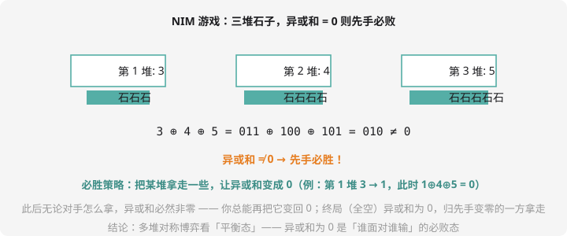

# 博弈论入门

## 一类新问题：两个人的完美对决

「Alice 和 Bob 轮流操作，不能动的人输。两人都绝顶聪明，谁必胜？」——**博弈论**研究的就是这类问题。注意措辞：不是「谁会赢」，而是**在双方都不犯错的前提下，谁一定赢**。

## 必败态与必胜态

定义两个状态（对「即将行动的人」而言）：

- **必败态（P-position）**：轮到你行动，无论你怎么走，对手都必胜
- **必胜态（N-position）**：你至少有一种走法，把对手送进必败态

两条判定规则（一切的源头）：

1. **无法行动的状态是必败态**（没有出路）
2. **能走到必败态的状态是必胜态；所有走法都通向必胜态的状态是必败态**

这三句话就是博弈论的全部公理——大定理都是它们的推论。

## 经典模型 1：巴什博奕

$n$ 个石子，轮流拿 1~m 个，拿走最后一个的胜。结论：**$(n) \bmod (m+1) \ne 0$ 则先手必胜**。

直觉：无论对手拿多少（$x$ 个），你凑够 $m+1$（拿 $m+1-x$ 个）——每轮固定消掉 $m+1$，主动权在你。剩 $m+1$ 的倍数给对手 = 必败态。

## 经典模型 2：NIM 游戏



$n$ 堆石子，轮流从**某一堆**拿走任意个（至少 1 个），拿走最后一颗的胜。

结论（NIM 定理）：**所有堆的石子数异或和为 0 → 先手必败；否则先手必胜**。

为什么异或？异或和 $\ne 0$ 时，总能拿掉某堆的一部分让异或和归零（取该堆最高位所在的 1 配平）；异或和 $= 0$ 时，任何一步操作都会破坏成非零——**你永远把 0 留给对手，对手永远把非零还给你**。终局（全空，异或和 0）恰好落在对手头上。

这就是第 9 章位运算 `^` 的最深用法：**异或和是「平衡态」的探测器**。

## 例题：NIM 对局

> **题目描述**　$T$ 组询问。每组第一行 $n$，第二行 $n$ 个整数表示各堆石子数。先手是否必胜？胜输出 `Win`，败输出 `Lose`。
>
> **输入格式**　见上。
>
> **输出格式**　$T$ 行。
>
> **数据范围**　$1 \le T \le 100$，$1 \le n \le 10^4$，石子数 $\le 10^9$。
>
> **样例输入 / 样例输出**
>
> ```text
> 2
> 3
> 3 4 5
> 3
> 1 2 3
> ```
>
> ```text
> Win
> Lose
> ```

**思路分析**　NIM 定理直接套：算异或和。第一组 $3 \oplus 4 \oplus 5 = 010 \ne 0$ → Win（必胜第一步：把 3 拿成 1，即拿走 2 个，使 $1 \oplus 4 \oplus 5 = 0$）；第二组 $1 \oplus 2 \oplus 3 = 01 \oplus 10 \oplus 11 = 0$ → Lose。✅

**参考代码**

```cpp
#include <iostream>
using namespace std;

int main() {
    int T;
    cin >> T;
    while (T--) {
        int n;
        cin >> n;
        long long x, sum = 0;
        for (int i = 0; i < n; i++) {
            cin >> x;
            sum ^= x;
        }
        cout << (sum != 0 ? "Win" : "Lose") << "\n";
    }
    return 0;
}
```

同款题：洛谷搜「NIM 游戏」。变体「Nim 游戏 II」（每堆限拿）异或规则换成「各堆剩余可拿数异或」—— Grün 定理，思路同源。

## 通用解法：状态博弈 DP

没有定理可背的博弈题，用第 8 章 DP + 两条公理硬算：

**状态**：`f[s]` = 状态 s 对行动者是必胜（true）还是必败（false）。

**转移**：`f[s] = true` ⇔ 存在一条边 `s → t` 使 `f[t] = false`（把对手送进必败态）。

自博弈树**从终局倒推**（终局全是必败），等价于在「博弈图」上做拓扑式 DP——第 11 章「拓扑序 + DP」的又一应用。数据小时也可以直接记忆化搜索（第 4 章的记忆化！）。

## 博弈论三件套总览

| 模型 | 结论 |
| ---- | ---- |
| 巴什博奕（拿 1~m） | $n \bmod (m+1) \ne 0$ 先手胜 |
| NIM（多堆任拿） | 异或和 ≠ 0 先手胜 |
| 一般博弈 | 必败/必胜态 DP（倒推） |

## 动手试一试

1. 手推 1~10 个石子、每次拿 1~3 的必败态序列（答案：4 的倍数必败）
2. 两堆各 3 颗的 NIM：异或和为 0 必败——但先手把一堆拿成 1 颗后局面变成 1,3，异或 2 ≠ 0……验证必胜方还有解
3. 「台阶 NIM」：石子在楼梯上，从台阶 i 拿到 i-1，拿地面者胜。结论只看**奇数台阶**的异或和——想想为什么（偶数台阶的移动可以对称抵消）
4. 挑战：用「必败态 DP」硬算 5 以内所有 NIM 局面（枚举异或和为 0 的状态集合），对比定理输出

---

**第 15 章毕业，全站 16 章完工！** 回到[备赛指南](../contest/index.md)规划你的 CSP 征程，或从[第 0 章](../start/index.md)再来一遍温故知新。
