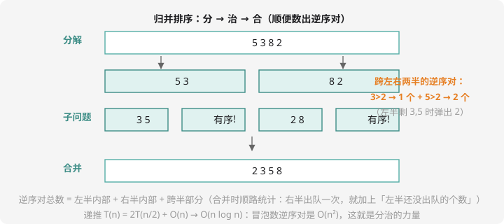

# 分治

## 分治三步曲

**分治（divide and conquer）**：把大问题切成两个**同类小问题**，各自解决，再合并结果：

1. **分**：按位置对半切
2. **治**：递归解决两半
3. **合**：把两半的答案合并成整体答案

递推式 $T(n) = 2T(n/2) + O(n)$ 解出 $O(n \log n)$——**比平方级省一个 n**。你已经见过两个分治产品：归并排序（第 5 章预告）和 sort() 的底层（快速排序）。



## 例题：逆序对

> **题目描述**　数列 $a_1 \ldots a_n$，若 $i < j$ 且 $a_i > a_j$ 称为一对逆序对。求逆序对总数。
>
> **输入格式**　第一行一个整数 $n$；第二行 $n$ 个整数。
>
> **输出格式**　一个整数。
>
> **数据范围**　$1 \le n \le 5 \times 10^5$，$|a_i| \le 10^9$，答案可能超 int。
>
> **样例输入 / 样例输出**
>
> ```text
> 4
> 5 3 8 2
> ```
>
> ```text
> 4
> ```

**思路分析**　逆序对是「前面比后面大」的配对。按位置对半分：**左半内部的 + 右半内部的 + 跨半的**——前两个递归解决，跨半的在**归并合并**时顺路统计：左右两半各自有序，右半每弹出一个数，左半剩下的数全部比它大（它们位置在前、值更大），逆序对 +「左半剩余个数」。

手验样例：`[5,3,8,2]` → 逆序对 (5,3)、(5,2)、(8,2)、(3,2) 共 **4** 个。冒泡式双重循环是 $O(n^2)$，$5 \times 10^5$ 必挂；归并版 $O(n \log n)$ 秒过。

**参考代码**

```cpp
#include <iostream>
using namespace std;

int a[500005], tmp[500005];
long long cnt = 0;

void mergeSort(int l, int r) {
    if (l >= r) return;
    int mid = (l + r) / 2;
    mergeSort(l, mid);           // 左半排好 + 统计左半内部
    mergeSort(mid + 1, r);       // 右半排好 + 统计右半内部

    int i = l, j = mid + 1, k = l;
    while (i <= mid && j <= r) {
        if (a[i] <= a[j]) {
            tmp[k++] = a[i++];
        } else {
            cnt += mid - i + 1;  // 右半 a[j] 出队：左半剩余的都 > 它
            tmp[k++] = a[j++];
        }
    }
    while (i <= mid) tmp[k++] = a[i++];
    while (j <= r)   tmp[k++] = a[j++];
    for (int x = l; x <= r; x++) a[x] = tmp[x];
}

int main() {
    int n;
    cin >> n;
    for (int i = 1; i <= n; i++) cin >> a[i];
    mergeSort(1, n);
    cout << cnt << endl;
    return 0;
}
```

细节：`<=`（相等不算逆序）；`cnt` 用 long long（$n(n-1)/2$ 最大约 $1.25 \times 10^{11}$）。这就是洛谷 [P1908 逆序对](https://www.luogu.com.cn/problem/P1908)——分治的必做题。同一问题也能用树状数组求（值域统计，第 10 章练习 4 预告过），两种解法都值得掌握。

## 分治的通用价值

| 应用 | 分的是什么 | 合的是什么 |
| ---- | ---- | ---- |
| 归并排序 / 逆序对 | 序列对半 | 有序合并 |
| 快速幂（第 15 章） | 幂指数对半 | 平方相乘 |
| 平面最近点对（了解） | 点集按 x 对半 | 检查跨越中线的点对 |
| 树的点分治（NOI 级） | 选重心分棵 | 统计过重心的路径 |

判断信号：**「序列上统计某种配对/结构」且暴力是平方级** → 先想「对半分 + 归并合并」能不能顺路统计。

## 快速选择：分治的变体（认识）

只求「第 k 小的数」而不需要全排序：快排式划分后，看 k 落在哪一侧，**只递归那一侧**——平均 $O(n)$。STL 的 `nth_element` 就是它，求「前 k 小/大」的利器。

## 动手试一试

1. 手模样例：画出 `[5,3,8,2]` 的完整分治递归树，标出每次合并统计到的逆序对数
2. 求区间逆序对数（洛谷 P10503? 搜「区间逆序对」）超纲——但「全局逆序对 + 树状数组」版本值得写一遍（第 10 章练习 4 的答案）
3. 快速幂预演：$2^{10}$ 用「分治」视角手算（$2^{10} = (2^5)^2$……共 4 次乘法 vs 连乘 9 次）——第 15 章的引子
4. 挑战：平面最近点对（洛谷 P1429）——按 x 对半，答案 = min(左半、右半、跨越中线的点对)；跨越部分用「按 y 排序 + 邻近检查」剪枝

---

下一课：用一个数组预存所有「2 的幂长区间」——[倍增与 ST 表](doubling.md)。
