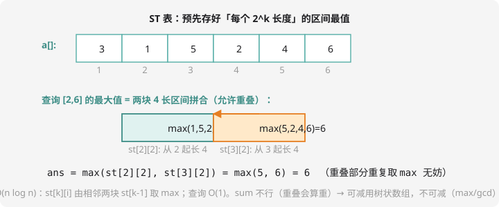

# 倍增与 ST 表

## 倍增思想：任何数都是 2 的幂之和

任何非负整数都能写成若干个 2 的幂之和（这就是二进制！）：$13 = 8 + 4 + 1$。

**倍增（binary lifting）**把这句话当武器：想知道「从位置 i 走 13 步」的信息？先跳 $2^3=8$ 步、再跳 $2^2=4$ 步、再跳 $2^0=1$ 步——**任何步数拆成 ≤ log 次的 2 的幂跳跃**。为此预处理 `f[k][i]` = 「从 i 出发跳 $2^k$ 步」的信息（由两个 $2^{k-1}$ 合成）：

$$f[k][i] = \text{merge}(f[k-1][i],\ f[k-1][i + 2^{k-1}])$$

预处理 $O(n \log n)$，单次跳跃查询 $O(\log n)$——和第 10 章树状数组的 lowbit 跳法异曲同工，但倍增**不要求可减**，用途更广。

## ST 表：静态区间最值的 O(1) 查询



**状态**：`st[k][i]` = 从 i 开始、长度 $2^k$ 的区间的最大值。

**转移**：两块长度 $2^{k-1}$ 的相邻区间取 max。

**查询** $[l, r]$：取 $k = \lfloor \log_2 (r-l+1) \rfloor$，用两块长度 $2^k$ 的区间（一块贴左端、一块贴右端）**完全覆盖**目标区间——中间重叠部分**重复取 max 不影响结果**：

$$\max(l, r) = \max\big(st[k][l],\ st[k][r - 2^k + 1]\big)$$

单次查询 $O(1)$！注意它**只能查不能改**（修改后整张表要重算）——静态数据的奢侈品。

```cpp
#include <iostream>
using namespace std;

long long st[21][100005];   // st[k][i]：从 i 起长 2^k 的最大值
int lg[100005];

int main() {
    ios::sync_with_stdio(false);
    cin.tie(nullptr);
    int n, m;
    cin >> n >> m;
    for (int i = 1; i <= n; i++) cin >> st[0][i];
    lg[1] = 0;
    for (int i = 2; i <= n; i++) lg[i] = lg[i / 2] + 1;   // 预处理 log2

    for (int k = 1; (1 << k) <= n; k++)
        for (int i = 1; i + (1 << k) - 1 <= n; i++)
            st[k][i] = max(st[k-1][i], st[k-1][i + (1 << (k-1))]);

    while (m--) {
        int l, r;
        cin >> l >> r;
        int k = lg[r - l + 1];
        cout << max(st[k][l], st[k][r - (1 << k) + 1]) << "\n";
    }
    return 0;
}
```

这就是洛谷 [P3865 【模板】ST 表](https://www.luogu.com.cn/problem/P3865)——$n, m \le 10^5$ 且**卡常**的题，线段树能过但 ST 表更快（O(1) 查询碾压）。

手验一组：`a = [3,1,5,2,4,6]`（下标 1~6），查询 [2,6]：长 5，k=2；两块 `[2..5]` max=5、`[3..6]` max=6；答案 $\max(5,6) = 6$ ✓（对照上方图示）。

**为什么 sum 不行？**两块重叠会算重——可减的（和）用前缀和/树状数组，不可减的（max、gcd）才轮到 ST 表。

## 倍增的旗舰应用：LCA

树链上两个节点的**最近公共祖先（LCA）**是提高篇图论题的标配子问题。倍增求法：

1. `dep[u]` = 深度；`f[k][u]` = u 向上跳 $2^k$ 步到达的祖先
2. 查询：先把深的点跳到与浅点同层，再两个点**从大幂到小幂**同步往上跳（跳过头就跳一半），直到跳到 LCA 的孩子

```cpp
// f[k][u] = f[k-1][ f[k-1][u] ]   预处理
// 查询 lca(a, b)：深者先跳 dep 差；再从大到小枚举 k：
//   f[k][a] != f[k][b] → a、b 同时跳 f[k]，最后答案 f[0][a]
```

单次查询 $O(\log n)$。洛谷 [P3379 【模板】LCA](https://www.luogu.com.cn/problem/P3379) 是必做题。「树上两点路径的最大边权」= LCA 跳的过程中顺带维护边权 max——第 11 章最小生成树的变体题全部解锁。

## 倍增家族一览

| 应用 | f[k][i] 的含义 | 单次查询 |
| ---- | ---- | :--: |
| ST 表 | 从 i 长度 $2^k$ 区间的 max | $O(1)$ |
| LCA | i 的 $2^k$ 级祖先 | $O(\log n)$ |
| 快速幂（第 15 章） | $x^{2^k}$ | $O(\log n)$ |
| 序列跳跃 | i 走 $2^k$ 步的位置 | $O(\log n)$ |

**共同心法**：「走 $x$ 步」拆成「2 的幂组合」；信息能「两两合并」就能倍增。

## 动手试一试

1. 手算：`a = [3,1,5,2,4,6]` 的 st[0]、st[1]（所有长 2 区间的 max）全部填出
2. LCA 骨架补全：画出 `1-2, 1-3, 2-4, 2-5` 的树，求 lca(4,5)（答案 2）并写出跳转过程
3. 思考：ST 表查区间和为什么错？（重叠算重）那 gcd 为什么可以？（重叠取 gcd 不影响结果）
4. 挑战：P3379 提交 LCA 模板；然后做「树上两点路径最大边权」——MST + LCA 跳跃时维护边权 max

---

下一课：数论武器库开箱——[第 15 章 · 竞赛数学进阶](../adv-math/index.md)。
