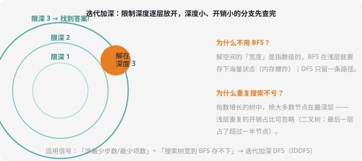

# 迭代加深与双向搜索

## 困境：BFS 爆内存，DFS 找不到「最少」

「求最少步数」按理该 BFS（第 7 章），但搜索树的**宽度**是指数级时，BFS 在浅层就要把海量状态全塞进队列——内存先爆炸。DFS 内存友好，可它一条道走到黑，找到的第一个解未必是「最少」的。

**迭代加深（IDDFS）**是两种优点的合体：

> **限制深度 d = 1, 2, 3, …… 逐个放宽，每个 d 做一次「限深 DFS」。**
> 第一个在限深内找到的解，就是最少步数的解。



「浅层重复搜索不亏」的数学：指数树里最后一层占了过半节点，浅层重扫的开销占比趋近于零——**用时间的小浪费，换内存的大节约**。

配套技巧：**可行性预判（估价函数）**——限深 d 时先估算「从当前状态到目标至少还要几步」，超过剩余深度就剪掉。这个「至少还要几步」的保守估计就是**启发函数**，估得越准剪得越狠（A* 算法的种子思想，NOI 级再深入）。

## 例题：埃及分数

> **题目描述**　把分数 $a/b$（$a < b$）表示成**最少个数的互不相同的单位分数**（分子为 1 的分数）之和。输出最少项数。
>
> **输入格式**　一行两个整数 $a$、$b$（$1 \le a < b \le 1000$）。
>
> **输出格式**　一个整数（最少项数；题目保证有解）。
>
> **数据范围**　经典问题（源自古埃及纸草书）。
>
> **样例输入 / 样例输出**
>
> ```text
> 5 6
> ```
>
> ```text
> 2
> ```
>
> （$5/6 = 1/2 + 1/3$，两项即可。）

**思路分析**　为什么这题非迭代加深不可？

- 「最少项数」—— 求最小 → 该 BFS；但分母的选择范围近乎无限，**BFS 的队列撑不住**
- 项数=2 试一次限深 2 的 DFS（枚举两个分母，剪枝：每个单位分数必须 $< $ 剩余量、$\ge$ 剩余量/(剩余可分项数)）；失败再试限深 3、4……

**参考代码**

```cpp
#include <iostream>
using namespace std;

int a, b, bestDepth;
long long ans[10], cur[10];   // 分母序列

// 还剩 rem/b 未凑、还剩 step 项可分；从 last+1 的下一项开始选
bool dfs(int step, int rem, int last) {
    if (step == bestDepth) {
        return rem == 1 && last < b;   // 最后一项必须是 1/(某数) 且严格递增
    }
    // 剪枝：分母下界（保证递增且不超剩余）与上界（1/x ≤ rem/b → x ≥ b/rem）
    long long lo = max<long long>(last + 1, b / rem + 1);
    long long hi = (long long)(bestDepth - step + 1) * b / rem;   // 剩余全用最小可行值的上界
    for (long long x = lo; x <= hi; x++) {
        // 新余数 = rem/b - 1/x = (rem*x - b)/(b*x)
        long long nrem = rem * x - b, nden = (long long)b * x;
        if (nrem <= 0) continue;
        cur[step] = x;
        if (dfs(step + 1, nrem, x)) return true;
    }
    return false;
}

int main() {
    cin >> a >> b;
    for (bestDepth = 1; bestDepth <= 8; bestDepth++) {
        if (dfs(0, a, 0)) { cout << bestDepth << endl; return 0; }
    }
    return 0;
}
```

验证样例：限深 1 失败（$5/6$ 不是单位分数）；限深 2 时枚举 $x < y$，$x = 2$ 后剩余 $5/6 - 1/2 = 1/3$ → $y = 3$ ✓ 输出 2。**估价剪枝**是本题的灵魂：分母下界（递增 + 不超剩余）、上界（剩余每项至少 `b/rem`）——没有这两条，搜索树无边无际。洛谷搜「埃及分数」有同款题。

## 双向搜索：两头往中间走

另一条降维思路：知道**起点和终点**时，从两边同时各搜一半，在中点汇合。状态从 $2^d$ 变成约 $2^{d/2} \times 2$——**开方级缩减**（$10^6 \to 2000$）。

经典场景「八数码难题」「字符串最少变换步数」：正向搜到的每个状态放进哈希表，反向搜索每扩展一步就查表——查到即接通。第 10 章的哈希表在这里发电。

## 两个信号，两种对策

| 信号 | 对策 |
| ---- | ---- |
| 求最少 + 宽度爆炸 | 迭代加深（IDDFS）+ 估价剪枝 |
| 明确起点终点 + 状态可反向生成 | 双向 BFS / 双向 DFS + 哈希会师 |

## 动手试一试

1. 手算迭代加深的总节点数：深度 3 的满二叉树，限深 1+2+3 三次搜索共访问多少节点？占总数比例？（答案 15 个中约 7 个是重复——占比仍小）
2. 埃及分数 $3/7$：手算两项不行、三项 `1/3 + 1/11 + 1/231`? 用程序验证最少项数（答案 3）
3. 写双向 BFS 骨架：两个队列交替扩展，各维护 `unordered_set`，扩展时查对面集合——伪代码 20 行以内
4. 挑战：八数码难题（洛谷 P1379）——双向 BFS 或 A*（曼哈顿距离估价），体会估价函数的威力

---

下一课：把大问题对半砍——[分治](divide.md)。
