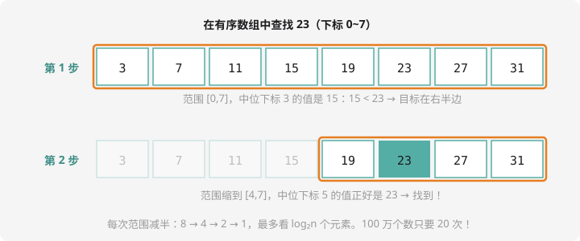

# 二分查找与二分答案

## 从猜数字说起

我心中想一个 1~100 的数，你来猜，我只答「大了」或「小了」。怎么猜最快？

- 从 1 开始一个个问：运气差要 100 次
- **每次猜区间正中间**：50 →「小了」→ 75 →「大了」→ 62……每问一次，**范围砍一半**。$100 \to 50 \to 25 \to 12 \to 6 \to 3 \to 1$，最多 **7 次**必中

这就是**二分**：每次把搜索范围减半。它的效率是碾压级的——100 万个数只要 20 次，10 亿个数只要 30 次。

## 二分查找：在有序数组中定位



二分有个**前提：数据必须有序**（从小到大或从大到小）——「大了/小了」的反馈只有对有序数据才有意义。

模板（左闭右闭区间写法）：

```cpp
int l = 0, r = n - 1;        // 在 a[l..r] 里找 x
while (l <= r) {             // 区间还有东西就继续
    int mid = (l + r) / 2;   // 中点
    if (a[mid] == x) return mid;   // 找到了
    if (a[mid] < x) l = mid + 1;   // 中点太小 → 目标在右半
    else r = mid - 1;              // 中点太大 → 目标在左半
}
return -1;                   // 走到这还没找到：不存在
```

三个易错点（笔考点！）：`l <= r` 不能写成 `l < r`（会漏掉最后一个候选）；往右走是 `mid + 1`、往左是 `mid - 1`（不加不减会死循环）；`(l + r) / 2` 在 $l,r$ 都很大时可能溢出 int，稳妥写法 `l + (r - l) / 2`。

## 例题 1：二分查找

> **题目描述**　给出 $n$ 个**已按升序排好**的整数和 $q$ 次询问，每次询问一个数 $x$：若在数组中输出它的**下标**（多个取最小下标），不在输出 `-1`。
>
> **输入格式**　第一行 $n$；第二行 $n$ 个升序整数；第三行 $q$；接下来 $q$ 行每行一个整数 $x$。
>
> **输出格式**　$q$ 行，每行一个下标或 `-1`。
>
> **数据范围**　$1 \le n, q \le 10^5$，$|a_i|, |x| \le 10^9$。
>
> **样例输入 / 样例输出**
>
> ```text
> 8
> 3 7 11 15 19 23 27 31
> 3
> 23
> 5
> 31
> ```
>
> ```text
> 5
> -1
> 7
> ```

**思路分析**　$q$ 次询问共 $10^5$ 次，每次线性扫描是 $10^5 \times 10^5 = 10^{10}$ 次——必超时。这正是二分的主场：每次 $O(\log n)$，总共约 $10^5 \times 17 \approx 1.7 \times 10^6$ 次，轻松通过。**「数据有序 + 查询量大」就是二分的出场信号。**

「多个取最小下标」怎么处理？找到 `a[mid] == x` 时别急着返回，**继续往左半边找**（`r = mid - 1`），看有没有更早的——这个变体叫「找左边界」。

**参考代码**

```cpp
#include <iostream>
using namespace std;

long long a[100005];

int main() {
    int n;
    cin >> n;
    for (int i = 0; i < n; i++) cin >> a[i];

    int q;
    cin >> q;
    while (q--) {
        long long x;
        cin >> x;
        int l = 0, r = n - 1, ans = -1;
        while (l <= r) {
            int mid = l + (r - l) / 2;
            if (a[mid] == x) {
                ans = mid;      // 先记下来……
                r = mid - 1;    // ……再往左找找有没有更小的下标
            } else if (a[mid] < x) {
                l = mid + 1;
            } else {
                r = mid - 1;
            }
        }
        cout << ans << endl;
    }
    return 0;
}
```

## 例题 2：猜数字

> **题目描述**　心中想一个 $1 \sim 100$ 的数 $x$。每一轮你报一个猜测 $g$，系统回答 `bigger`（$g < x$）、`smaller`（$g > x$）或 `equal`。求**最坏情况下**最少需要猜几次才能保证猜中。
>
> **输入格式**　无。
>
> **输出格式**　一个整数。

**思路分析**　答案就是 $\lceil \log_2 100 \rceil = 7$。但别背结论——用二分思想推：每猜一次最坏排除一半，$100 \to 50 \to 25 \to 13 \to 7 \to 4 \to 2 \to 1$，恰好 7 步。**任何**目标数都逃不过 7 次这张网，而且 6 次不够（$2^6 = 64 < 100$）。这就是「最坏情况下最少」的含义——二分是猜数字游戏的**理论最优策略**。

**参考代码**（模拟二分过程计数）

```cpp
#include <iostream>
using namespace std;

int main() {
    int l = 1, r = 100, cnt = 0;
    while (l < r) {              // 区间没缩成一个数就继续
        cnt++;
        int mid = l + (r - l) / 2;
        // 最坏情形：答案总在剩下的一半里
        r = mid;                 // 直接取左半继续（次数与取哪半无关）
    }
    cout << cnt << endl;         // 7
    return 0;
}
```

## 二分答案：更狠的用法（预告）

二分不仅能查「位置」，还能查「**答案本身**」——只要答案具有单调性。

> 「把一根长度为 $L$ 的木棒截成 $k$ 段，每段最长能多长？」
> 每段越长，能截的段数越少——**单调**！于是「猜一个长度 mid → 验证能不能截出 k 段 → 大了往回收、小了往外放」，和猜数字一模一样。

这就是**二分答案**，CSP-J 后期和 CSP-S 的大杀器之一。现在记住口诀：**答案单调可验证，就二分猜它**，具体套路提高篇展开。

## 动手试一试

1. 手推：在 `2 5 8 12 16 23 38 56 72 91` 中二分找 23，写出每一步的 `l, r, mid`
2. 修改例题 1：改成输出**最大下标**（找右边界），拿重复数据测一测
3. 猜数字 1~1000 最坏几次？1~$10^9$ 呢？（心算 $\log_2$）
4. 思考：为什么「无序数组」不能二分查找？试着构造一个反例说明会漏解

---

下一章，数据开始排队站好：[第 6 章 · 简单数据结构](../ds/index.md)。
