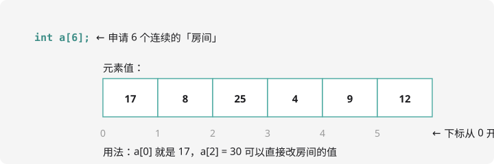

# 一维数组与桶计数

## 为什么需要数组？

要记录全班 50 位同学的成绩，定义 `score1`、`score2`……`score50`？代码没法看。**数组**一次开出一排带编号的「房间」：

```cpp
int score[50];   // 50 个连续的 int 房间，编号 0 ~ 49
```



## 基本用法

```cpp
int a[6] = {17, 8, 25, 4, 9, 12};  // 定义并初始化
cout << a[0] << endl;              // 访问 0 号房间：17
a[2] = 30;                         // 把 2 号房间的值改成 30
```

三个铁规矩：

1. **下标从 0 开始**：`a[6]` 的合法下标是 0~5，`a[6]` 这个房间**不存在**
2. **越界不报错**：C++ 不检查下标，`a[100]` 可能读到垃圾值、甚至让程序离奇崩溃——**数组越界是竞赛里最隐蔽的错误**
3. **大小最好是常量**：`int n; cin >> n; int a[n];` 这种「变长数组」不标准，竞赛中请 `int a[100005];` 开够题目上限

## 和循环是天作之友

下标是规律的，用 `for` 遍历一气呵成：

```cpp
#include <iostream>
using namespace std;

int main() {
    int a[10];
    int n = 10;
    for (int i = 0; i < n; i++) {   // 读入
        cin >> a[i];
    }
    int sum = 0;
    for (int i = 0; i < n; i++) {   // 求和
        sum += a[i];
    }
    cout << sum << endl;
    return 0;
}
```

## 桶计数：数组的第一个大招

问题：读入 $n$ 个数（每个数都在 1~100 之间），问每个数出现了多少次？

开 100 个「桶」，数字是几就丢进几号桶，最后数每个桶里有多少个：

```cpp
#include <iostream>
using namespace std;

int cnt[105];   // 桶数组，cnt[v] 表示数字 v 出现的次数

int main() {
    int n;
    cin >> n;
    for (int i = 0; i < n; i++) {
        int x;
        cin >> x;
        cnt[x]++;          // 数字 x 出现一次，x 号桶 +1
    }
    for (int v = 1; v <= 100; v++) {
        if (cnt[v] > 0) {
            cout << v << " 出现了 " << cnt[v] << " 次" << endl;
        }
    }
    return 0;
}
```

注意妙处：**不需要先读完全部再统计**——来一个数记一个，`cnt[x]++` 一行搞定，连数组存原始数据都省了。

!!! tip "桶思想的应用"

    「统计字母出现次数」→ 开 `cnt[26]`，用 `c - 'a'` 当下标；
    「判断哪些数出现过」→ 桶里存 0/1 当标记。这个套路第 5 章枚举、
    后面很多算法里都会反复出现。

## 初始化的小知识

- 定义在 `main` **外面**的全局数组会自动清零：`int cnt[105];` 全是 0，可直接 `cnt[x]++`
- 定义在 `main` 里面的局部数组初值是**随机垃圾**，用前要先清：`memset` 或写循环赋 0，也可以 `int a[10] = {};` 全零初始化

竞赛代码习惯把大数组开成**全局数组**，就图「自动清零 + 栈空间无忧」。

## 动手试一试

1. 读入 10 个整数，**倒序**输出
2. 读入 n 个 0~9 的数字，输出出现次数最多的数字（如有多个输出最小的）
3. 经典开灯问题：n 盏灯初始全亮，经过 k 轮，第 i 轮拨动所有编号是 i 的倍数的灯（亮变灭、灭变亮），问最后哪些灯灭着（提示：模拟 + 数组标记）
4. 挑战：统计一句话里 26 个字母各出现多少次（不区分大小写，用 `char` 数组 + `getline` 读整行）

---

下一课，让数据排好队：[排序：冒泡与选择](sort.md)。
