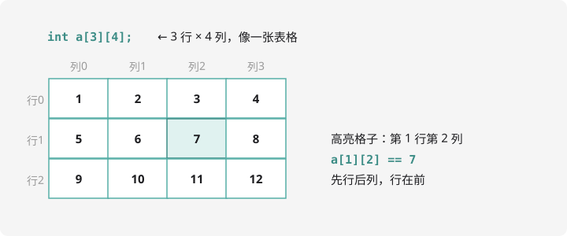

# 二维数组与字符串

## 二维数组：一排房间变成一栋楼

一维数组是一排房间，**二维数组就是一栋楼**：每层有若干房间，用「楼层 + 房号」定位：

```cpp
int a[3][4];   // 3 行 × 4 列，共 12 个 int
```



```cpp
int a[3][4] = {
    {1, 2, 3, 4},
    {5, 6, 7, 8},
    {9, 10, 11, 12}
};
cout << a[1][2] << endl;   // 第 1 行第 2 列：7（行列都从 0 数）
```

遍历用**双重循环**：外层扫行、内层扫列：

```cpp
for (int i = 0; i < 3; i++) {        // 每一行
    for (int j = 0; j < 4; j++) {    // 行内每一列
        cout << a[i][j] << " ";
    }
    cout << endl;
}
```

经典应用：**矩阵**题目（读入矩阵、输出转置、求对角线之和）和**棋盘**类题目（井字棋、迷宫地图）。比如迷宫题里 `mp[i][j]` 表示第 i 行第 j 列是空地还是墙——第 7 章搜索会大量使用。

!!! tip "行列别搞反"

    `a[i][j]` 是**先行后列**。写迷宫代码时把行列弄反，程序不会报错但答案离谱，
    调试时先检查是不是这个问题。

## string：字符串入门

`string` 是 C++ 自带的字符串类型，比字符数组好用得多：

```cpp
#include <iostream>
#include <string>     // string 需要
using namespace std;

int main() {
    string name;
    cin >> name;               // 读入一个单词（空格/回车结束）
    cout << "你好, " << name << "!" << endl;
    cout << "长度: " << name.size() << endl;
    return 0;
}
```

常用操作一览：

| 操作 | 写法 | 说明 |
| ---- | ---- | ---- |
| 长度 | `s.size()` 或 `s.length()` | 字符个数 |
| 取单个字符 | `s[i]` | 和数组一样，下标从 0 开始 |
| 比较 | `s1 < s2` | 按字典序，直接用比较符 |
| 拼接 | `s1 + s2` | 加号直接连起来 |
| 判断相等 | `s1 == s2` | C 里要 strcmp，C++ 直接 == |
| 截取 | `s.substr(pos, len)` | 从 pos 开始取 len 个字符 |

## 遍历字符串：回放数位拆分

统计字符串中数字字符的个数：

```cpp
#include <iostream>
#include <string>
using namespace std;

int main() {
    string s;
    cin >> s;
    int cnt = 0;
    for (int i = 0; i < (int)s.size(); i++) {
        if (s[i] >= '0' && s[i] <= '9') cnt++;   // 是数字字符
    }
    cout << cnt << endl;
    return 0;
}
```

记住两个关键事实：

1. 字符可以直接比大小：`s[i] >= '0'` 用的是字符的**编码值**（`'0'` 是 48，`'9'` 是 57，连续）
2. `s[i] - '0'` 把数字字符变成对应整数：`'8' - '0'` 得 `8`——**字符转数字的唯一公式**

!!! warning "cin 读不了带空格的一句话"

    `cin >> s` 遇空格就停。读整行用 `getline(cin, s);`。
    注意它常和 `cin >>` 混用出坑：`cin >> n` 后立即 `getline` 会读到残留的换行，
    中间加一句 `getchar();`（或 `cin.ignore();`）吃掉换行即可。

## 综合练习：回文判断

判断一个字符串是不是回文（正读反读一样，如 `level`）：

```cpp
#include <iostream>
#include <string>
using namespace std;

int main() {
    string s;
    cin >> s;
    bool ok = true;
    int len = s.size();
    for (int i = 0; i < len / 2; i++) {
        if (s[i] != s[len - 1 - i]) {   // 首尾对称位置比较
            ok = false;
            break;
        }
    }
    cout << (ok ? "yes" : "no") << endl;
    return 0;
}
```

用到了**首尾指针**思想：一个从前往后、一个从后往前，对称检查。这个技巧后面还会见到。

## 动手试一试

1. 读入 3×3 矩阵，输出它的转置（行列互换）
2. 读入一个字符串，统计大写字母、小写字母、数字各有多少个
3. 读入单词，把其中所有小写字母变成大写输出（提示：`c - 32` 或 `c - 'a' + 'A'`）
4. 挑战：读入一句话（`getline`），统计其中单词的个数（连续字母算一个单词）

---

**恭喜，CSP-J 入门篇前 3 章毕业！** 下一章把代码模块化：[第 4 章 · 函数与递归](../function/index.md)。
