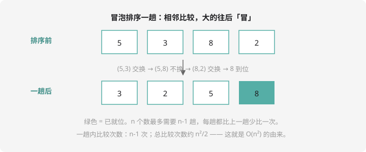
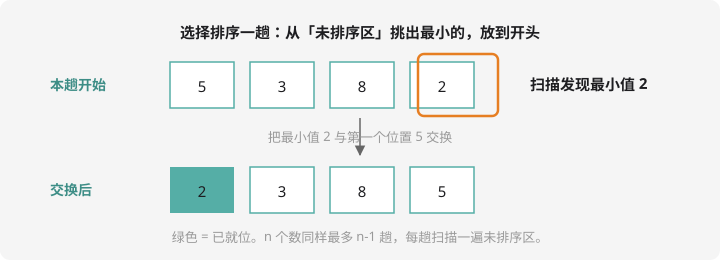

# 排序：冒泡与选择

把数据从小到大（或从大到小）排好，是无数算法的前置步骤。这一课先**手写**两种最经典的排序理解原理，再学考场利器 `sort()`。

## 冒泡排序：大的往后冒

一趟一趟地扫描，相邻两个数比较，逆序就交换——每一趟下来，当前最大的数就像气泡一样「冒」到末尾。



```cpp
#include <iostream>
using namespace std;

int a[1005];

int main() {
    int n;
    cin >> n;
    for (int i = 0; i < n; i++) cin >> a[i];

    for (int i = 0; i < n - 1; i++) {        // 共 n-1 趟
        for (int j = 0; j < n - 1 - i; j++) { // 每趟比到「未排序区」末尾
            if (a[j] > a[j + 1]) {           // 前面的更大 → 交换
                int t = a[j];
                a[j] = a[j + 1];
                a[j + 1] = t;
            }
        }
    }

    for (int i = 0; i < n; i++) cout << a[i] << " ";
    return 0;
}
```

看懂两个细节：

- 内层 `j < n-1-i`：每趟结束后末尾已就位的数不用再比，所以每趟少比一个
- **交换三步曲**：借助临时变量 `t`，像两杯水交换要先倒进第三个杯子

## 选择排序：挑最小的站前排

每一趟从未排序区**选出最小值**，和未排序区的第一个位置交换。



```cpp
for (int i = 0; i < n - 1; i++) {
    int mn = i;                          // 记录最小值的位置
    for (int j = i + 1; j < n; j++) {
        if (a[j] < a[mn]) mn = j;        // 发现更小的，更新位置
    }
    if (mn != i) {                       // 最小值不在首位，交换一次
        int t = a[i]; a[i] = a[mn]; a[mn] = t;
    }
}
```

和冒泡比一比：选择排序每趟**只交换一次**（先记位置再交换），交换次数远少于冒泡。两种排序都是约 $n^2/2$ 次比较，效率同一档次，都属于「简单但慢」的排序。

## 考场利器：sort()

竞赛允许使用 STL。`sort()` 一行搞定，速度还是它们的百倍以上（$O(n \log n)$，提高级再讲为什么）：

```cpp
#include <algorithm>   // sort 所在头文件
sort(a, a + n);                    // 把 a[0] ~ a[n-1] 从小到大
sort(a, a + n, greater<int>());    // 从大到小
```

!!! tip "两手都要硬"

    原理上会手写（笔试考冒泡/选择的代码阅读和填空），
    考场上用 `sort()`（又快又不容易错）。两行都不亏。

## 排序的思想比排序本身重要

很多题不需要真的排序，只需要排序的**思路**：

- 「输出第 k 大的数」→ 不用全排，找到那个数即可
- 「成绩排名」→ 排序后下标就是名次
- 「按多个关键字排序」→ 先比第一关键字，相同再比第二关键字（`sort` 的自定义比较会随第 6 章结构体一起讲）

## 例题 1：整数排序

> **题目描述**　读入 $n$ 个整数，**从小到大**排序后输出。
>
> **输入格式**　第一行一个整数 $n$；第二行 $n$ 个整数。
>
> **输出格式**　一行 $n$ 个整数，升序，空格分隔。
>
> **数据范围**　$1 \le n \le 100000$，$|a_i| \le 10^9$。
>
> **样例输入 / 样例输出**
>
> ```text
> 5
> 5 3 8 2 9
> ```
>
> ```text
> 2 3 5 8 9
> ```

**思路分析**　$n$ 达到十万级，冒泡的 $n^2$ 次比较会超时——这正是 `sort()` 登场的时刻（它的复杂度是 $O(n \log n)$，十万数据瞬间完成）。

**参考代码**

```cpp
#include <iostream>
#include <algorithm>
using namespace std;

int a[100005];

int main() {
    int n;
    cin >> n;
    for (int i = 0; i < n; i++) cin >> a[i];
    sort(a, a + n);   // 升序
    for (int i = 0; i < n; i++) cout << a[i] << " ";
    cout << endl;
    return 0;
}
```

变式：降序只需改成 `sort(a, a + n, greater<int>());`。另外注意数组开在全局（十万级的大数组别放 `main` 里）。

## 例题 2：奖学金（简化版）

> **题目描述**　全班 $n$ 名同学考语、数、英三门，按**总分从高到低**排名，输出前 5 名的学号和总分。学号就是输入顺序（$1 \sim n$），题目保证任意两人总分不相等。
>
> **输入格式**　第一行一个整数 $n$；接下来 $n$ 行，每行三个整数，表示语数英成绩。
>
> **输出格式**　5 行，每行「学号 总分」。
>
> **数据范围**　$6 \le n \le 300$，每科成绩 $0 \sim 150$。
>
> **样例输入 / 样例输出**
>
> ```text
> 6
> 90 90 90
> 100 95 85
> 80 80 80
> 70 100 100
> 60 60 60
> 95 95 95
> ```
>
> ```text
> 2 280
> 6 285
> ```

（样例展示格式用；实际输出为总分前 5 名，依次为 `2 280`、`6 285`、`1 270`、`4 270`、`3 240`。）

**思路分析**　难点在于：排序的是**总分**，但要**同步携带学号**一起移动。办法是用两个数组 `id[]` 和 `sum[]`，交换时成对交换——上一课学的「借杯子交换」这里要换两次。

**参考代码**

```cpp
#include <iostream>
using namespace std;

int id[305], sum[305];

int main() {
    int n;
    cin >> n;
    for (int i = 1; i <= n; i++) {
        int a, b, c;
        cin >> a >> b >> c;
        id[i] = i;
        sum[i] = a + b + c;
    }

    // 冒泡排序：总分从高到低，学号跟随总分一起交换
    for (int i = 1; i < n; i++) {
        for (int j = 1; j <= n - i; j++) {
            if (sum[j] < sum[j + 1]) {
                int t = sum[j]; sum[j] = sum[j + 1]; sum[j + 1] = t;
                t = id[j];      id[j] = id[j + 1];     id[j + 1] = t;
            }
        }
    }

    for (int i = 1; i <= 5; i++) {
        cout << id[i] << " " << sum[i] << endl;
    }
    return 0;
}
```

完整的规则版（总分相同比语文、再比学号）就是洛谷 [P1093 奖学金](https://www.luogu.com.cn/problem/P1093)——它需要「结构体 + 自定义比较」，学完第 6 章回头再看会轻松很多。

## 动手试一试

1. 读入 n 个数，用冒泡排序从大到小输出（改哪个符号？）
2. 读入 n 个学生的姓名和成绩，按成绩从高到低输出名单（成绩相同按姓名字典序）——先试着只用成绩做
3. 思考题：冒泡排序一趟（不是 n-1 趟）结束后，数组一定有什么特征？
4. 笔试演练：给你 4 个数 `{5, 3, 8, 2}`，写出冒泡排序第 2 趟结束后的数组（不看图，自己模拟）

---

下一课：把数组排成表格、把字符连成句子——[二维数组与字符串](2d-string.md)。
