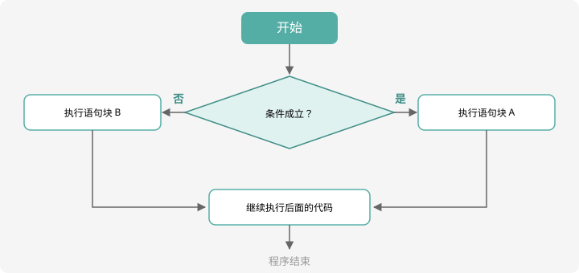

# if 分支结构

## 为什么需要分支？

程序目前只会「从头走到尾」。但生活里充满选择：**红灯停、绿灯行**；考了 90 分以上妈妈奖励冰淇淋，否则……程序也一样需要「看情况做事」，这就是**分支结构**。

## if 语句：满足条件才做

```cpp
if (条件) {
    // 条件成立时执行的代码
}
```



!!! note "怎么读流程图"

    菱形是**判断**，矩形是**动作**，箭头是**流程**。程序运行到菱形处检查条件：
    成立走「是」这条线，不成立走「否」这条线，殊途同归汇合到后面。

比如：判断一个数是不是正数：

```cpp
int n;
cin >> n;
if (n > 0) {
    cout << "n 是正数" << endl;
}
```

## if-else：二选一

不成立时也有话说，用 `else`：

```cpp
if (n % 2 == 0) {
    cout << "偶数" << endl;
} else {
    cout << "奇数" << endl;
}
```

这段代码是**互斥**的：两个输出语句永远只会执行一个。

## else if：多分支

超过两种情况时，用 `else if` 串起来。经典的**成绩等级**题：

```cpp
#include <iostream>
using namespace std;

int main() {
    int score;
    cin >> score;

    if (score >= 90) {
        cout << "优秀" << endl;
    } else if (score >= 80) {
        cout << "良好" << endl;
    } else if (score >= 60) {
        cout << "及格" << endl;
    } else {
        cout << "不及格" << endl;
    }
    return 0;
}
```

!!! tip "多分支的顺序很重要"

    程序**从上往下**逐个检查，命中一个就跳过剩下所有分支。
    所以 `score >= 90` 必须放在 `score >= 80` 前面——反过来写，85 分会先被 `>= 80` 接住，永远到不了「优秀」。

## 关系运算符与逻辑运算符

条件本质上是「一个结果是真假的式子」。关系运算符：

| 运算符 | 含义 | 例子 |
| :--: | ---- | ---- |
| `==` | 等于 | `a == 5` |
| `!=` | 不等于 | `a != 0` |
| `>` `<` `>=` `<=` | 大小比较 | `score >= 60` |

多个条件可以用**逻辑运算符**连接：

| 运算符 | 含义 | 例子 |
| :--: | ---- | ---- |
| `&&` | 并且（都要成立） | `n % 3 == 0 && n % 5 == 0` |
| `\|\|` | 或者（至少一个成立） | `ch == 'y' \|\| ch == 'Y'` |
| `!` | 取反 | `!(n > 0)` 即 n 不大于 0 |

!!! warning "新手第一坑：= 和 =="

    `=` 是**赋值**，`==` 才是**判断相等**。写成 `if (a = 5)` 是「把 5 赋给 a」，
    条件永远为真，而且编译器只给个警告。**看见 if 里的 `=` 就要警惕**。

## 闰年判断：综合应用

判断 $y$ 年是不是闰年（经典笔试题）：**能被 4 整除但不能被 100 整除，或者能被 400 整除**。

```cpp
#include <iostream>
using namespace std;

int main() {
    int y;
    cin >> y;
    if ((y % 4 == 0 && y % 100 != 0) || y % 400 == 0) {
        cout << "yes" << endl;
    } else {
        cout << "no" << endl;
    }
    return 0;
}
```

对照读题：`能被4整除 且 不能被100整除` → `(y%4==0 && y%100!=0)`；`或者能被400整除` → `|| y%400==0`。**把中文条件逐句翻译成表达式**，是做这类题的通用方法。

## switch：多分支的另一种写法（了解）

当判断的是「某变量等于哪个具体值」时，`switch` 更整齐：

```cpp
switch (weekday) {
    case 1: cout << "周一" << endl; break;
    case 6: cout << "周六" << endl; break;
    case 7: cout << "周日" << endl; break;
    default: cout << "工作日" << endl; break;
}
```

注意每个分支末尾的 `break;`——漏掉它会「顺流」执行下一个分支。竞赛中 `if / else if` 更万能，`switch` 会读会写即可。

## 动手试一试

1. 读入一个整数，输出它是正数、负数还是零（三分支）
2. 读入三个整数，输出其中最大的那个（提示：先比较前两个，再和第三个比）
3. 读入年份，判断闰年（用上面的代码验证：2000 年 yes，1900 年 no，2024 年 yes）
4. 挑战： BMI = 体重(kg) ÷ 身高²(m²)，读入身高体重，按区间输出「偏瘦/正常/偏胖」（自定标准即可）

---

下一课，程序学会「重复做事」：[for 与 while 循环](loop.md)。
