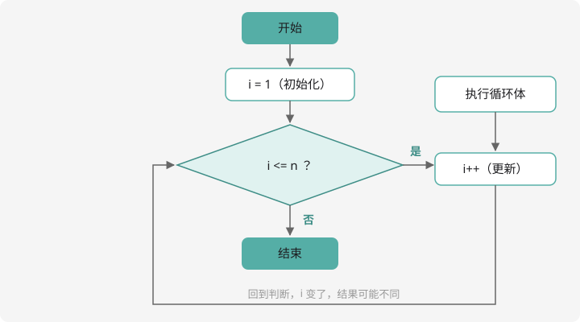

# for 与 while 循环

## 为什么需要循环？

计算 $1+2+3+\cdots+100$，总不能写 100 遍 `+`。凡是「重复做类似的事」，就该交给**循环**——让电脑干它最擅长的体力活。

## for：最常用的循环

```cpp
for (初始化; 条件; 更新) {
    // 循环体：重复执行的代码
}
```



三要素对应流程图里的三个框：**先初始化 → 判断条件 → 成立就执行循环体 → 更新 → 再判断……**直到条件不成立。

用它算 $1+2+\cdots+100$：

```cpp
#include <iostream>
using namespace std;

int main() {
    int sum = 0;              // 累加器，先清零
    for (int i = 1; i <= 100; i++) {
        sum += i;             // 每轮把 i 加进 sum
    }
    cout << sum << endl;      // 5050
    return 0;
}
```

变量 `i` 叫**循环变量**，它像计数员：第 1 轮是 1，第 2 轮是 2……第 100 轮是 100，然后 `i` 变成 101，条件 `i <= 100` 不成立，循环结束。

## while：先看条件再说

```cpp
while (条件) {
    // 循环体
}
```

`while` 只管条件，更新藏在循环体里。同样的求和用 `while` 写：

```cpp
int sum = 0, i = 1;
while (i <= 100) {
    sum += i;
    i++;                  // 千万别忘了更新，否则死循环！
}
```

**选择建议**：知道循环几次，用 `for`；只知道「满足条件就继续」，用 `while`。

!!! danger "死循环"

    条件永远成立（或忘了更新循环变量）时，程序会永远转下去，评测机上就是
    **超时 0 分**。本地运行发现程序「卡住不输出」，先想想是不是死循环。

## 经典套路一：数位拆分

读入一个整数，求它各位数字之和。用上一章学的 `% 10` 和 `/ 10`，配合循环：

```cpp
#include <iostream>
using namespace std;

int main() {
    int n, sum = 0;
    cin >> n;
    while (n > 0) {
        sum += n % 10;   // 取出个位，累加
        n /= 10;         // 砍掉个位
    }
    cout << sum << endl;
    return 0;
}
```

以 `n = 123` 为例走一遍：`sum += 3, n 变 12` → `sum += 2, n 变 1` → `sum += 1, n 变 0` → 循环结束，`sum = 6`。

**「%10 取个位、/10 砍个位」是处理数位问题的万能钥匙**，CSP 每年都考。

## 经典套路二：找最大值

读入 n 个数，输出最大值。「擂台赛」思路：先让第一个数当擂主，后面每个数来挑战，赢的留下：

```cpp
#include <iostream>
using namespace std;

int main() {
    int n, x, mx;
    cin >> n;
    cin >> x;
    mx = x;                    // 第一个数当擂主
    for (int i = 2; i <= n; i++) {
        cin >> x;
        if (x > mx) mx = x;    // 挑战者更大，换擂主
    }
    cout << mx << endl;
    return 0;
}
```

## break 与 continue：循环的刹车和跳过

- `break;` —— **立刻终止整个循环**
- `continue;` —— **跳过本轮剩下的语句，直接进入下一轮**

```cpp
for (int i = 1; i <= 10; i++) {
    if (i == 5) continue;   // i=5 时跳过下面一句
    if (i == 8) break;      // i=8 时整个循环结束
    cout << i << " ";
}
// 输出：1 2 3 4 6 7
```

经典应用——**辗转相除法**求最大公约数（笔试常客，先记模板，第 9 章详细讲）：

```cpp
int a = 12, b = 18;
while (b != 0) {
    int t = a % b;
    a = b;
    b = t;
}
// 循环结束后 a 就是最大公约数：6
```

## 循环嵌套：双重 for

循环里面再套循环。打印 $n \times n$ 的星号方阵：

```cpp
int n = 4;
for (int i = 1; i <= n; i++) {      // 控制「行」
    for (int j = 1; j <= n; j++) {  // 控制「列」
        cout << "* ";
    }
    cout << endl;                   // 每行结束换行
}
```

外层走一步，内层走完一圈。九九乘法表只需把内层条件改成 `j <= i`。

!!! warning "性能意识（提前建立）"

    双重循环是 $n \times n$ 次运算。竞赛里 $n$ 达到 $10^4$ 级别时双重循环就是
    $10^8$ 次——开始接近时间上限。**先估算运算量再动手**，这个习惯从现在养起。

## 例题 1：阶乘

> **题目描述**　读入 $n$，输出 $n! = 1 \times 2 \times 3 \times \cdots \times n$。
>
> **输入格式**　一个非负整数 $n$（$0! = 1$）。
>
> **输出格式**　一个整数，即 $n!$。
>
> **数据范围**　$0 \le n \le 20$。
>
> **样例输入 / 样例输出**
>
> ```text
> 5
> ```
>
> ```text
> 120
> ```

**思路分析**　「累乘」和「累加」只差一个运算符：累加器从 `0` 开始 `sum += i`，累乘器从 `1` 开始 `res *= i`——**从 0 乘就全毁了**。另外 $20! \approx 2.4 \times 10^{18}$，必须用 `long long`。

**参考代码**

```cpp
#include <iostream>
using namespace std;

int main() {
    int n;
    cin >> n;
    long long res = 1;          // 累乘器从 1 开始
    for (int i = 2; i <= n; i++) {
        res *= i;
    }
    cout << res << endl;
    return 0;
}
```

试试 $n = 21$：结果是负数——溢出了。这就是为什么题目把 $n$ 限制在 20。

## 例题 2：最大公约数

> **题目描述**　读入两个正整数 $a$、$b$，输出它们的最大公约数。
>
> **输入格式**　一行两个整数 $a$、$b$。
>
> **输出格式**　一个整数，即 $a$ 与 $b$ 的最大公约数。
>
> **数据范围**　$1 \le a, b \le 10^9$。
>
> **样例输入 / 样例输出**
>
> ```text
> 12 18
> ```
>
> ```text
> 6
> ```

**思路分析**　用**辗转相除法**（欧几里得算法）：$a$ 和 $b$ 的最大公约数，等于 $b$ 和 $a \% b$ 的最大公约数。比如

$$\gcd(12, 18) = \gcd(18, 12) = \gcd(12, 6) = \gcd(6, 0) = 6$$

余数为 0 时，除数就是答案。所以「不停地用余数替换，直到余数为 0」——一个标准 while 循环。

**参考代码**

```cpp
#include <iostream>
using namespace std;

int main() {
    long long a, b;
    cin >> a >> b;
    while (b != 0) {
        long long t = a % b;   // 先算出余数
        a = b;                 // 除数变成新的被除数
        b = t;                 // 余数变成新的除数
    }
    cout << a << endl;
    return 0;
}
```

这个模板请直接背下来，第 9 章「竞赛数学」还会再见到它。

## 动手试一试

1. 用循环输出 1~100 中所有 3 的倍数，每行 5 个（提示：计数换行）
2. 读入 $n$，求 $n!$（阶乘：$1 \times 2 \times \cdots \times n$），试试 $n=20$ 会发生什么（回扣 long long 溢出）
3. 读入一个整数，把它**倒序输出**（如 123 → 321）
4. 打印九九乘法表，注意用 `\t` 对齐
5. 挑战：读入 $n$ 个学生的成绩，输出平均分和最高分

---

下一课，我们一次存放一大排数据：[一维数组与桶计数](../array/1d-array.md)。
