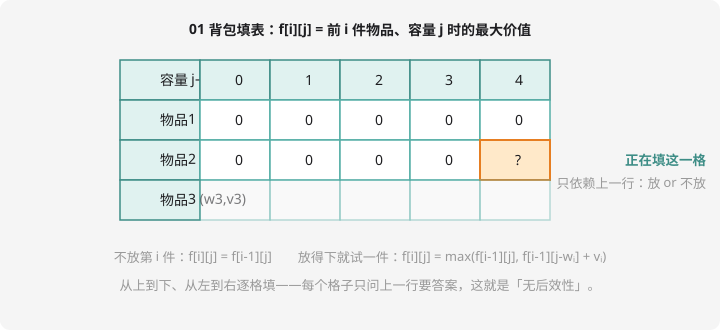

# 背包问题

## 背包是什么？

经典故事：一个容量有限的背包，面前一堆**有重量、有价值**的物品，怎么装使总价值最大？根据「每件物品能拿几件」，分成几个变种：

| 变种 | 规则 | 本课 |
| ---- | ---- | :--: |
| **01 背包** | 每件最多拿 1 件 | ✅ |
| **完全背包** | 每件无限拿 | ✅ |
| 多重背包 | 每件限 $c_i$ 件 | 认识即可 |

背包是 CSP-J 动态规划的第一大考点（第二轮几乎每年出现），也是一切「选与不选」类问题的原型。

## 01 背包

> $n$ 件物品，第 $i$ 件重量 $w_i$、价值 $v_i$。背包容量 $C$。每件**要么拿、要么不拿**，求最大总价值（不要求装满）。

### 二维状态设计



**状态**：`f[i][j]` = 只考虑前 $i$ 件物品、背包容量为 $j$ 时能拿到的最大价值。

**转移**：第 $i$ 件物品**拿或不拿**，二选一：

- 不拿：`f[i-1][j]`
- 拿（需要 $j \ge w_i$）：先腾出 $w_i$ 空间 → `f[i-1][j-w_i] + v_i`

$$f[i][j] = \max(f[i-1][j],\ f[i-1][j-w_i] + v_i)$$

**边界**：`f[0][j] = 0`（一件都没得考虑，价值 0）。**答案**：`f[n][C]`。

对着填表图理解：填第 2 行（考虑物品 2）时只问第 1 行——**每行只依赖上一行，同行互不依赖**。这个「无后效性」是 DP 正确性的基石。

```cpp
#include <iostream>
using namespace std;

long long f[105][10005];   // n≤100, C≤10000 的典型规模

int main() {
    int n, C;
    cin >> n >> C;
    long long w[105], v[105];
    for (int i = 1; i <= n; i++) cin >> w[i] >> v[i];

    for (int i = 1; i <= n; i++) {
        for (int j = 0; j <= C; j++) {
            f[i][j] = f[i-1][j];                        // 不拿
            if (j >= w[i])                              // 拿得下才考虑拿
                f[i][j] = max(f[i][j], f[i-1][j-w[i]] + v[i]);
        }
    }
    cout << f[n][C] << endl;
    return 0;
}
```

### 一维优化（考场标准写法）

观察填表图：第 i 行只用到第 i-1 行，且 `j-w[i]` 在 j 左边。于是把第一维压掉，`f[j]` 表示「当前考虑到的物品、容量 j」：

```cpp
for (int i = 1; i <= n; i++)
    for (int j = C; j >= w[i]; j--)      // ① 必须倒序！
        f[j] = max(f[j], f[j - w[i]] + v[i]);
```

**为什么倒序？**正序时 `f[j - w[i]]` 是**本行**刚更新过的值——相当于物品 i 被拿了两次，那成了完全背包。倒序保证 `f[j-w[i]]` 还是上一行的旧值：**每件物品只拿一次**。01 背包与完全背包的分水岭就在这一个循环方向，笔试超爱考。

## 完全背包

每件物品**无限供应**。状态定义不变，转移里「拿一件之后还可以继续拿」——所以取值要来自**本行**：

$$f[i][j] = \max(f[i-1][j],\ f[i][j-w_i] + v_i)$$

代码上就是把循环方向改成**正序**：

```cpp
for (int i = 1; i <= n; i++)
    for (int j = w[i]; j <= C; j++)      // 正序：允许重复拿
        f[j] = max(f[j], f[j - w[i]] + v[i]);
```

一行代码之差，两个问题分道扬镳。**对比着背，永远不会混**：

| | 循环方向 | `f[j-w[i]]` 的含义 |
| ---- | :--: | ---- |
| 01 背包 | 倒序 | 上一行（这件还没考虑过）|
| 完全背包 | 正序 | 本行（这件刚拿过，还能再拿）|

## 例题 1：采药

> **题目描述**　山上采药：总时间 $T$，$n$ 株草药，第 $i$ 株需要 $t_i$ 时间、价值 $v_i$。每株只能采一次。求采药总价值最大。
>
> **输入格式**　第一行 $T, n$；接下来 $n$ 行每行 $t_i, v_i$。
>
> **输出格式**　一个整数。
>
> **数据范围**　$1 \le T \le 1000$，$1 \le n \le 100$，$1 \le t_i, v_i \le 100$。
>
> **样例输入 / 样例输出**
>
> ```text
> 70 3
> 71 100
> 69 1
> 1 2
> ```
>
> ```text
> 3
> ```

**思路分析**　「时间→重量、价值不变」——01 背包换皮题。信奥圈名言：**「一切「在预算内选物品最大化收益」都是背包」**。样例专门考你：第一株要 71 分钟装不下，只能采后两株得 3。

**参考代码**

```cpp
#include <iostream>
using namespace std;

long long f[1005];

int main() {
    int T, n;
    cin >> T >> n;
    long long t[105], v[105];
    for (int i = 1; i <= n; i++) cin >> t[i] >> v[i];

    for (int i = 1; i <= n; i++)
        for (int j = T; j >= t[i]; j--)       // 01 背包倒序
            f[j] = max(f[j], f[j - t[i]] + v[i]);

    cout << f[T] << endl;
    return 0;
}
```

这就是洛谷 [P1048 采药](https://www.luogu.com.cn/problem/P1048)，NOIP2005 普及组真题——**「 Medicine 采药 = 背包」**这个映射关系建立起来，一类题就全通了。

## 例题 2：零钱问题（完全背包）

> **题目描述**　有 $n$ 种硬币，每种面值 $a_i$、每种**数量无限**。凑出恰好 $S$ 元，最少用几枚硬币？凑不出输出 `-1`。
>
> **输入格式**　第一行 $n, S$；第二行 $n$ 个整数 $a_i$。
>
> **输出格式**　最少硬币数或 `-1`。
>
> **数据范围**　$1 \le n \le 100$，$1 \le S \le 10^4$，$1 \le a_i \le S$。
>
> **样例输入 / 样例输出**
>
> ```text
> 3 11
> 1 5 7
> ```
>
> ```text
> 3
> ```

**思路分析**　完全背包变体：把「最大价值」改成「最少枚数」——转移从 `max` 换成 `min`。**「恰好凑出 S」**要求初始化讲究：`f[0] = 0`，其余设为无穷大（表示还没凑出），转移 `f[j] = min(f[j], f[j-a[i]] + 1)`，最后 `f[S]` 若仍是无穷大则输出 `-1`。

**参考代码**

```cpp
#include <iostream>
using namespace std;

long long f[10005];   // 存「最少硬币数」，INF 表示凑不出

int main() {
    int n, S;
    cin >> n >> S;
    long long a[105];
    for (int i = 1; i <= n; i++) cin >> a[i];

    const long long INF = 1e9;
    for (int j = 1; j <= S; j++) f[j] = INF;   // f[0] = 0
    for (int i = 1; i <= n; i++)
        for (int j = a[i]; j <= S; j++)         // 完全背包正序
            if (f[j - a[i]] + 1 < f[j])
                f[j] = f[j - a[i]] + 1;

    cout << (f[S] >= INF ? -1 : f[S]) << endl;
    return 0;
}
```

验证样例：$11 = 7 + 1 + 1$ 或 $5 + 5 + 1$，都是 3 枚；贪心会用 $7+1+1+1+1$ 共 5 枚——**又见贪心翻车，DP 正解**。

## 动手试一试

1. 手填 01 背包二维表：3 件物品 `(w,v)` = `(2,3)(3,4)(4,5)`，C=5，验证答案 7
2. 把采药的循环方向改成**正序**，用原样例测试——结果变成什么？为什么错了？（体会倒序的意义）
3. 「恰好装满」版 01 背包：初始化改成 `f[0]=0` 其余 INF，输出 `f[C]` 或 `-1`
4. 挑战：多重背包初体验——每种硬币限用 $c_i$ 枚，怎么转化成 01 背包？（提示：把 $c_i$ 枚拆成 $c_i$ 件独立物品即可，虽然慢但能过小数据）

---

下一章：第一轮笔试的半壁江山——[第 9 章 · 竞赛数学基础](../math/index.md)。
