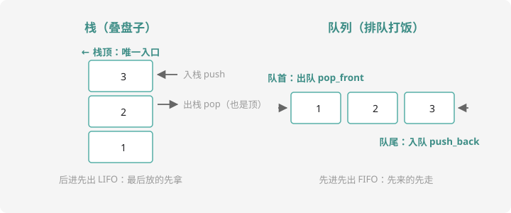

# 栈与队列

## 两种有规矩的容器

数组想从哪进出都行，但很多问题的数据**天生有进出规矩**。两种最经典：



- **栈（stack）**：只有一个口，从顶进、从顶出——**后进先出**（LIFO），像叠盘子
- **队列（queue）**：一头进另一头出——**先进先出**（FIFO），像排队打饭

C++ 的 STL 提供了现成的 `stack`、`queue`（`#include <stack>` / `<queue>`），但竞赛中**先用数组手写模拟**——原理透明，考场不慌，笔试还常考手写。

## 栈：数组模拟

```cpp
char stk[10005];   // 栈体
int top = 0;       // 栈顶指针：0 表示空栈

// 入栈（push）
stk[++top] = 'x';
// 出栈（pop）
top--;
// 看栈顶（peek）
char c = stk[top];
// 判空
bool empty = (top == 0);
```

`top` 就是「最上面那个盘子的位置」。入栈先挪位置再放东西（`++top`），出栈只挪位置不擦东西（旧数据留着无妨，反正 `top` 之外的不算）。

### 栈的经典应用：括号匹配

括号为什么用栈？因为**每个右括号要和「离它最近的、还没配对的」左括号配对**——这恰好是栈顶。左括号全部进栈；遇到右括号就看栈顶是不是对应左括号，是就弹栈配对。

## 队列：数组模拟

```cpp
int q[100005];
int head = 1, tail = 0;    // 队列内容是 q[head..tail]，head > tail 即空

// 入队（进队尾）
q[++tail] = x;
// 出队（队首离开）
head++;
// 判空
bool empty = (head > tail);
```

`head` 追着 `tail` 往前跑，跑过的空间就浪费了——但对多数题目（总操作数已知）开够数组即可，简单不出错。

### 队列的经典应用：约瑟夫问题

$n$ 个人围成圈报数，数到 $m$ 的人出圈，下一个人从 1 重新报。队列解法妙在：**出圈 = 真出队，没数到 = 出队再入队尾**（绕回圈的另一头）。

## 例题 1：括号匹配

> **题目描述**　读入一个只含 `()`、`[]`、`{}` 的字符串，判断括号是否全部正确配对。正确输出 `yes`，否则 `no`。
>
> **输入格式**　一行一个字符串（长度 $\le 10^4$）。
>
> **输出格式**　`yes` 或 `no`。
>
> **样例输入 / 样例输出**
>
> ```text
> ({[]})
> ```
>
> ```text
> yes
> ```
>
> 输入 `([)]` 输出 `no`（交错嵌套不合法）；输入 `((` 输出 `no`（有左括号落单）。

**思路分析**　三种不合法情况：① 右括号来了但栈顶不配对；② 右括号来了但栈已空；③ 结束时栈里还有剩。代码就是「左括号进栈、右括号查栈顶」两条规则 + 结尾清点。

**参考代码**

```cpp
#include <iostream>
#include <string>
using namespace std;

char stk[10005];
int top = 0;

bool match(char l, char r) {
    return (l == '(' && r == ')') || (l == '[' && r == ']')
        || (l == '{' && r == '}');
}

int main() {
    string s;
    cin >> s;
    bool ok = true;
    for (int i = 0; i < (int)s.size(); i++) {
        char c = s[i];
        if (c == '(' || c == '[' || c == '{') {
            stk[++top] = c;            // 左括号：进栈
        } else {
            if (top == 0 || !match(stk[top], c)) {   // ① ② 情况
                ok = false;
                break;
            }
            top--;                     // 配对成功，弹栈
        }
    }
    if (top != 0) ok = false;          // ③ 情况：左括号落单
    cout << (ok ? "yes" : "no") << endl;
    return 0;
}
```

洛谷搜「括号匹配」有同款题（进阶版含表达式、更多括号种类，套路完全一样）。

## 例题 2：约瑟夫问题

> **题目描述**　$n$ 个人围成一圈，编号 $1 \sim n$。从 1 号开始从 1 报数，报到 $m$ 的人出圈，他的下一位从 1 重新报数。按顺序输出所有出圈的人的编号。
>
> **输入格式**　一行两个整数 $n$、$m$。
>
> **输出格式**　一行，出圈顺序。
>
> **数据范围**　$1 \le n, m \le 100$。
>
> **样例输入 / 样例输出**
>
> ```text
> 5 3
> ```
>
> ```text
> 3 1 5 2 4
> ```

**思路分析**　队列视角：圈内的人排在队列里。每轮报数 = 从队首出队一个人；数到 $m$ 就出圈（不再入队），没数到就从队尾重新入队（相当于绕回圈子另一头继续）。出队 $n$ 次后结束。

**参考代码**

```cpp
#include <iostream>
using namespace std;

int q[20005], head = 1, tail = 0;

int main() {
    int n, m;
    cin >> n >> m;
    for (int i = 1; i <= n; i++) q[++tail] = i;   // 1~n 依次入队

    int cnt = 0;                    // 当前报到几
    for (int out = 0; out < n; ) {  // 出圈 n 人后结束
        int p = q[head++];          // 队首出队
        cnt++;
        if (cnt == m) {
            cout << p << " ";       // 数到 m：出圈
            out++;
            cnt = 0;
        } else {
            q[++tail] = p;          // 没数到：回队尾继续
        }
    }
    cout << endl;
    return 0;
}
```

拿样例走一遍：报 3 出圈的是 3；接着 4(1) 5(2) 1(3) → 1 出圈……输出 `3 1 5 2 4`。✅ 这就是洛谷 [P1996 约瑟夫问题](https://www.luogu.com.cn/problem/P1996)。下一课链表还能再解它一次——同一问题两种数据结构，体会各有千秋。

## 动手试一试

1. 用栈做回文判断：把字符串逐个进栈再逐个弹出，与原串比较（为什么这样能判断回文？）
2. 读入一串整数（以 0 结尾），用栈把它们**逆序**输出
3. 约瑟夫变体：数到 $m$ 的人出圈后，**从下一个人重新数 1** 改成「从出圈者本人重新数 1」，输出顺序有什么变化？改代码验证
4. 挑战：用队列模拟打印任务——$n$ 个任务带页数，打印机每秒打印 1 页，输出每个任务的完成时刻

---

下一课：插队神器——[链表](linked-list.md)。
