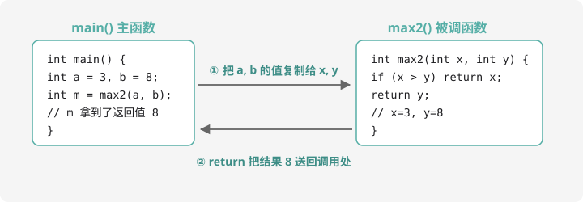

# 函数的定义与调用

## 为什么需要函数？

回想第 2 章的「找最大值」擂台代码：如果一道题要比较 10 组数据的大小，难道每次都把那段代码抄一遍？把一段常用代码**打包、起名字**，要用时喊一声就行——这就是**函数**。

你其实早就在用函数了：`main` 是主函数，`sort()`、`swap()`、`cin >>` 背后都是别人写好的函数。现在轮到我们自己写了。

## 定义一个函数



```cpp
返回类型 函数名(参数列表) {
    // 函数体：要干的事
    return 返回值;
}
```

写一个「返回两数中较大者」的函数：

```cpp
#include <iostream>
using namespace std;

int max2(int x, int y) {   // 定义：接住两个整数 x 和 y
    if (x > y) {
        return x;          // 返回较大的
    } else {
        return y;
    }
}

int main() {
    int a = 3, b = 8;
    int m = max2(a, b);    // 调用：m 得到 8
    cout << m << endl;
    return 0;
}
```

对照示意图理解调用的过程：

1. 主函数执行到 `max2(a, b)`，**暂停**
2. 把 `a`、`b` 的值**复制**给 `x`、`y`（注意是复制，改 `x` 不影响 `a`）
3. 执行函数体，遇到 `return` 把结果**送回**调用处
4. 主函数从暂停处继续，`m` 接住返回值

## void：只干活、不汇报的函数

不是所有函数都有返回值。比如「打印 n 个星号」，干完就回家，用 `void`（空）：

```cpp
void printStars(int n) {    // void = 没有返回值
    for (int i = 0; i < n; i++) {
        cout << "*";
    }
    cout << endl;
}

int main() {
    printStars(3);   // 直接调用，不需要接返回值
    printStars(5);
    return 0;
}
```

## 作用域：变量住在哪里？

```cpp
int g = 100;         // 全局变量：写在 main 外面，全程序都能用

void demo() {
    int local = 5;   // 局部变量：只在这个函数里活着
    g++;             // 全局变量，可以访问
}

int main() {
    demo();
    cout << g << endl;   // 101
    // cout << local;   // ❌ 编译错误！local 已经不存在了
    return 0;
}
```

- **全局变量**：定义在所有函数外面，大家共用，程序结束时才消失。竞赛里的大数组通常开成全局（自动清零、不怕栈空间不够，第 3 章说过）
- **局部变量**：定义在函数（或花括号）里面，出了这对花括号就消失

两个经典的坑：

1. 局部变量**没赋值就用**，里面是垃圾值
2. 函数参数名和全局变量重名时，函数里用的是**参数**（近水楼台）

## 例题：质数判断

> **题目描述**　读入 $n$ 个正整数，逐个判断是否为质数（素数）。是输出 `yes`，不是输出 `no`。
>
> **输入格式**　第一行一个整数 $n$；接下来 $n$ 行，每行一个正整数。
>
> **输出格式**　$n$ 行，每行 `yes` 或 `no`。
>
> **数据范围**　$n \le 100$，每个数 $\le 10^9$。
>
> **样例输入 / 样例输出**
>
> ```text
> 4
> 2
> 15
> 17
> 1
> ```
>
> ```text
> yes
> no
> yes
> no
> ```

**思路分析**　「判断质数」显然要被反复使用——正是函数的用武之地。质数定义：大于 1，且只能被 1 和它自己整除。判断方法：拿 $2, 3, 4, \ldots$ 逐个试除。

优化关键：如果 $n$ 有一个大于 $\sqrt{n}$ 的因数 $p$，那 $n / p$ 必然是小于 $\sqrt{n}$ 的因数。所以**只试除到 $\sqrt{n}$** 就够了，复杂度从 $n$ 次降到约 $\sqrt{n}$ 次——对 $10^9$ 的数就是从 10 亿次降到 3 万次的差距。

**参考代码**

```cpp
#include <iostream>
using namespace std;

// 判断 n 是不是质数：是返回 true，不是返回 false
bool isPrime(long long n) {
    if (n < 2) return false;           // 0、1 都不是质数（递归出口式的边界！）
    for (long long i = 2; i * i <= n; i++) {
        if (n % i == 0) return false;  // 找到因数，直接否决
    }
    return true;                        // 全部试完，没有因数
}

int main() {
    int n;
    cin >> n;
    for (int k = 0; k < n; k++) {
        long long x;
        cin >> x;
        if (isPrime(x)) cout << "yes" << endl;
        else cout << "no" << endl;
    }
    return 0;
}
```

三个值得咀嚼的细节：

1. `i * i <= n` 等价于 `i <= √n`，但避免了开方运算和浮点误差
2. `i` 用 `long long`：$i \times i$ 可能超 `int`（又是溢出！）
3. `return false` 一旦成立立即返回——「能早就早」是函数里的常用技巧

洛谷搜「质数筛」可以找到同款题（[P5736](https://www.luogu.com.cn/problem/P5736)）。

## 动手试一试

1. 写函数 `int cube(int x)` 返回 $x^3$，主函数里调用并输出
2. 写函数 `void greet(string name)` 打印「你好，XXX」，调用三次传不同名字
3. 写函数 `bool isLeap(int y)` 判断闰年（第 2 章的代码搬家！），主函数读入 5 个年份逐个判断
4. 思考：把例题里 `isPrime` 的 `i * i <= n` 改成 `i <= n`，程序还正确吗？会慢在哪里？

---

下一课：函数自己调用自己——[递归入门](recursion.md)。
