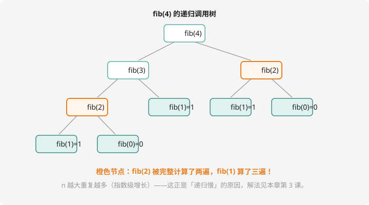

# 递归入门

## 什么是递归？

**递归就是函数自己调用自己。**

听起来像套娃：想知道 $4!$？那就是 $4 \times 3!$。想知道 $3!$？那就是 $3 \times 2!$……一层一层问下去，直到问到「$1!$ 等于几」——这个**不需要再往下问的问题**叫**递归出口**，然后一层一层把答案传回来。

## 递归三要素

每个递归函数都必须有这三样，缺一个就是死循环或错误答案：

1. **出口**：最简单的情况，直接给出答案
2. **自己调用自己**：把大问题变成更小的同类问题
3. **向出口逼近**：每次调用的规模都要变小

## 阶乘：最直白的递归

$$n! = n \times (n-1)!，\quad 1! = 1$$

翻译成代码几乎是逐字照抄：

```cpp
#include <iostream>
using namespace std;

long long fact(int n) {
    if (n <= 1) return 1;        // ① 出口：1! = 1
    return n * fact(n - 1);      // ②③ 调用自己，n-1 向出口逼近
}

int main() {
    int n;
    cin >> n;
    cout << fact(n) << endl;
    return 0;
}
```

以 `fact(4)` 为例，脑中放电影：

```text
fact(4) = 4 * fact(3)
             fact(3) = 3 * fact(2)
                          fact(2) = 2 * fact(1)
                                       fact(1) = 1   ← 出口！
                          返回 2
             返回 6
返回 24
```

## 斐波那契：递归的岔路口

斐波那契数列：$f(1)=f(2)=1$，之后每一项等于前两项之和 $1, 1, 2, 3, 5, 8, \ldots$



```cpp
long long fib(int n) {
    if (n <= 2) return 1;                 // 出口：前两项
    return fib(n - 1) + fib(n - 2);       // 前两项之和
}
```

代码很短，但看图：**fib(2) 被算了两遍，fib(1) 被算了三遍**！$n$ 越大重复越夸张——递归求 fib 的耗时是**指数级**的，$n = 40$ 就要算几亿次。

!!! tip "药方：记忆化（先尝一口，第 8 章细讲）"

    开一个数组把算过的结果存起来，再要用直接查表：

    ```cpp
    long long f[45];   // 全局数组自动清零，0 表示还没算过

    long long fib(int n) {
        if (n <= 2) return 1;
        if (f[n] != 0) return f[n];      // 算过了，直接拿
        return f[n] = fib(n - 1) + fib(n - 2);  // 算完顺手存起来
    }
    ```

    一行改动，从指数级变成 $O(n)$。**「递归 + 记忆化」就是动态规划的种子。**

## 汉诺塔：递归的思维巅峰

问题：三根柱子 A、B、C，A 上套着 $n$ 个大小不同的盘子（大的在下）。要把全部盘子搬到 C，每次只能移一个盘，且大盘永远不能压小盘。最少要移多少次？

直接想 $n=64$ 会疯掉，但递归只问一句：**「搬 $n$ 个盘」和「搬 $n-1$ 个盘」是不是一回事？**

1. 把上面 $n-1$ 个盘：A → B（借 C 暂存）
2. 把最大的盘：A → C（一步）
3. 把那 $n-1$ 个盘：B → C（借 A 暂存）

```cpp
#include <iostream>
using namespace std;

void move(int n, char from, char to, char via) {
    if (n == 0) return;                          // 出口：没盘可搬
    move(n - 1, from, via, to);                  // ① n-1 个先让路
    cout << "盘 " << n << ": " << from << " -> " << to << endl;  // ② 最大盘走
    move(n - 1, via, to, from);                  // ③ n-1 个跟上
}

int main() {
    int n;
    cin >> n;
    move(n, 'A', 'C', 'B');
    return 0;
}
```

数一数次数：$T(1) = 1$，$T(n) = 2T(n-1) + 1$，解出 $T(n) = 2^n - 1$。$n = 64$ 时约 $1.8 \times 10^{19}$ 次——传说中僧侣搬完塔世界就毁灭，数学上是真搬不完。

## 例题 1：斐波那契数

> **题目描述**　读入 $n$，输出斐波那契数列第 $n$ 项（$f(1) = f(2) = 1$）。
>
> **输入格式**　一个整数 $n$。
>
> **输出格式**　一个整数。
>
> **数据范围**　$1 \le n \le 30$。
>
> **样例输入 / 样例输出**
>
> ```text
> 10
> ```
>
> ```text
> 55
> ```

**思路分析**　直接套 `fib` 递归即可。范围限 30 是有讲究的：$n=30$ 时朴素递归约 160 万次调用能过；$n=40$ 就是 3 亿多次，**超时**——想突破就用记忆化，或者等第 8 章。

**参考代码**

```cpp
#include <iostream>
using namespace std;

long long fib(int n) {
    if (n <= 2) return 1;
    return fib(n - 1) + fib(n - 2);
}

int main() {
    int n;
    cin >> n;
    cout << fib(n) << endl;
    return 0;
}
```

## 例题 2：汉诺塔最少步数

> **题目描述**　读入盘子数 $n$，输出汉诺塔最少移动次数。
>
> **输入格式**　一个整数 $n$。
>
> **输出格式**　一个整数。
>
> **数据范围**　$1 \le n \le 30$。
>
> **样例输入 / 样例输出**
>
> ```text
> 10
> ```
>
> ```text
> 1023
> ```

**思路分析**　递推式 $T(n) = 2T(n-1) + 1$，出口 $T(1) = 1$。递归函数两行写完；也可以发现答案就是 $2^n - 1$，但递归写法更能体现「把大问题拆小」的思想。

**参考代码**

```cpp
#include <iostream>
using namespace std;

long long hanoi(int n) {
    if (n == 1) return 1;
    return 2 * hanoi(n - 1) + 1;
}

int main() {
    int n;
    cin >> n;
    cout << hanoi(n) << endl;
    return 0;
}
```

## 动手试一试

1. 手算 `fact(5)` 的完整调用展开（模仿本课的缩进格式写出来）
2. 修改斐波那契程序：加记忆化数组，然后 $n = 45$ 试跑，对比有无记忆化的等待时间
3. 汉诺塔 $n = 3$：在纸上画出 3 个盘的最少搬动方案，和程序输出的步骤对照
4. 思考：如果 `fact` 的出口写成 `if (n == 0) return 1;`，读入 0 会输出什么？读入 -1 会发生什么？

---

下一课：换一个方向想问题——[递推](recurrence.md)。
