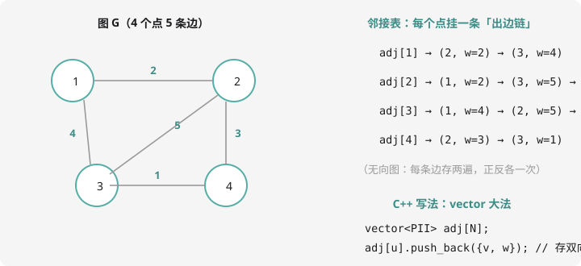

# 图的存储与遍历

## 图是什么？

**图（graph）= 一些点 + 一些连接点的边。**城市地图、朋友圈、电路板、任务依赖……全是图。竞赛约定：$n$ 个点 $m$ 条边。

基本术语（笔试高频）：

- **有向图**：边有方向（单行道）；**无向图**：边双向通行
- **带权图**：边上带数值（距离、时间、代价）
- **度**：与点相连的边数；有向图分入度/出度
- **连通**：任意两点互相可达；**连通块**：极大连通部分
- **环**：从某点出发沿边走回自己；无环的有向图叫 **DAG**（下一课主角）
- **树**：$n$ 个点 $n-1$ 条边、无环且连通的图——特殊的图，后面单讲

## 存图：邻接表（考场标配）



三种存法对比：

| 存法 | 空间 | 查「u,v 有边吗」 | 适用 |
| ---- | :--: | :--: | ---- |
| 邻接矩阵 `g[u][v]` | $O(n^2)$ ❗ | $O(1)$ | $n \le 5000$ 的稠密图、Floyd |
| 邻接表 `vector` | $O(n + m)$ ✅ | 要扫链 | **几乎所有题** |
| 链式前向星（数组模拟） | $O(n + m)$ | 要扫 | 怕 vector 开销的老选手 |

**考场首选 vector 邻接表**：

```cpp
#include <iostream>
#include <vector>
using namespace std;

const int N = 100005;
vector<pair<int,int>> adj[N];   // adj[u] = {邻居 v, 边权 w} 的列表

void addEdge(int u, int v, int w) {
    adj[u].push_back({v, w});   // 有向图：存一次
    adj[v].push_back({u, w});   // 无向图：正反各存一次！
}
```

回忆第 6 章链表——`adj[u]` 就是「u 的出边链」，vector 只是替你管链。**无向边存两遍**是最常见的丢分点，审代码先数 push_back。

## 遍历：把每个点都走到

第 7 章在网格上学的 DFS/BFS **原样适用**，只是「邻居」从四方向变成了 `adj[u]` 里的每一项。框架：

```cpp
bool vis[N];   // 防止绕圈

void dfs(int u) {
    vis[u] = true;
    // 在这里处理 u（进入时）
    for (auto [v, w] : adj[u]) {
        if (!vis[v]) dfs(v);
        // 回来后可处理「回边」（子→父、拓扑、树形DP 都在这句的位置做文章）
    }
}
```

BFS 版（最短路用）：

```cpp
queue<int> q;
q.push(s); vis[s] = true;
while (!q.empty()) {
    int u = q.front(); q.pop();
    for (auto [v, w] : adj[u]) {
        if (!vis[v]) { vis[v] = true; q.push(v); }
    }
}
```

## 例题：连通块计数

> **题目描述**　$n$ 个点、$m$ 条无向边的图，求连通块的个数。
>
> **输入格式**　第一行 $n, m$；接下来 $m$ 行每行两个整数 $u, v$，表示一条边。
>
> **输出格式**　一个整数。
>
> **数据范围**　$1 \le n \le 10^5$，$1 \le m \le 2 \times 10^5$。注意 $n$ 大，**递归 DFS 可能爆栈**，用 BFS 或手写栈。
>
> **样例输入 / 样例输出**
>
> ```text
> 6 4
> 1 2
> 2 3
> 4 5
> 6 4
> ```
>
> ```text
> 2
> ```

**思路分析**　每个未访问的点启动一次遍历，把整个连通块染上「访问标记」；启动次数就是连通块数。样例：{1,2,3} 和 {4,5,6} 两个块。并查集（第 10 章）也能做——merge 完数根，正好是同一问题的两种解法，**遍历版还能顺便记录每个点属于哪个块**。

**参考代码**

```cpp
#include <iostream>
#include <vector>
#include <queue>
using namespace std;

const int N = 100005;
vector<int> adj[N];
bool vis[N];

int main() {
    int n, m;
    cin >> n >> m;
    for (int i = 0; i < m; i++) {
        int u, v;
        cin >> u >> v;
        adj[u].push_back(v);   // 无向边，存两遍
        adj[v].push_back(u);
    }

    int blocks = 0;
    for (int s = 1; s <= n; s++) {
        if (!vis[s]) {
            blocks++;                 // 又发现一个新块，启动 BFS
            queue<int> q;
            q.push(s);
            vis[s] = true;
            while (!q.empty()) {
                int u = q.front(); q.pop();
                for (int v : adj[u]) {
                    if (!vis[v]) { vis[v] = true; q.push(v); }
                }
            }
        }
    }
    cout << blocks << endl;
    return 0;
}
```

同款题：洛谷 [P8686](https://www.luogu.com.cn/problem/P8686)（蓝桥杯真题）及各类「连通块」变体（数大小、染色、孤立点）。

## 动手试一试

1. 手写：样例的邻接表内容（1~6 号各挂了谁？注意无向边存两遍）
2. 改造例题：输出每个点所属的连通块编号（1~blocks，提示：vis 换成 blockId 数组）
3. 有向图版连通性：从 1 号出发能到哪些点？（不是连通块——有向图只有「可达」没有「块」）
4. 思考：邻接矩阵存 $n = 10^5$ 要多大内存？（$10^{10}$ 个 int ≈ 40GB！）所以大图必用邻接表——看清数据范围再选结构

---

下一课：图论第一硬菜——[最短路](shortest-path.md)。
