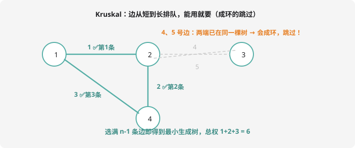

# 最小生成树

## 生成树问题是什么？

$n$ 个村庄要通网线，网线可以修在任何两村之间（代价不同）。**最少花多少钱，让所有村庄连通？**连好后恰好选了 $n-1$ 条边、无环、连通——正是一棵**生成树**；代价最小的方案叫**最小生成树（MST）**。

两种经典解法，思路完全相反：

- **Kruskal**：全局挑边——从便宜的开始买（本章主角）
- **Prim**：从一点长出——每次把离「已连通区」最近的点拉进来（思想同 Dijkstra，了解即可）

## Kruskal：并查集发电



三步曲：

1. **所有边按权从小到大排序**
2. 逐条查看：两端点**不连通**（根不同）→ 选它，merge 两端；**已连通**（成环）→ 跳过
3. 选满 $n-1$ 条边即得 MST

「判两端是否连通」正是第 10 章并查集的拿手戏——**Kruskal = 排序 + 并查集**。

```cpp
#include <iostream>
#include <algorithm>
using namespace std;

int fa[5005];

int find(int x) {
    if (fa[x] == x) return x;
    return fa[x] = find(fa[x]);      // 路径压缩
}

int main() {
    int n, m;
    cin >> n >> m;
    vector<array<int,3>> e(m);       // {w, u, v}
    for (auto& [w, u, v] : e) cin >> u >> v >> w;
    sort(e.begin(), e.end());        // 按权升序

    for (int i = 1; i <= n; i++) fa[i] = i;

    int cnt = 0;
    long long total = 0;
    for (auto& [w, u, v] : e) {
        int ru = find(u), rv = find(v);
        if (ru == rv) continue;      // 同根：成环，跳过
        fa[ru] = rv;                 // 合并
        total += w;
        cnt++;
        if (cnt == n - 1) break;     // 选满即停
    }
    if (cnt == n - 1) cout << total << endl;
    else cout << "orz" << endl;      // 图不连通，无生成树
    return 0;
}
```

复杂度 $O(m \log m)$（排序主导），并查集查询近乎常数。**为什么贪心是对的？**交换论证：如果 MST 里没用当前最小可行边 $e$，把它加进树会成环，环上必有比 $e$ 长的边，换掉它代价变小——与「最小」矛盾。比 Dijkstra 的贪心证明还直观。

## Prim：从一点长出（了解）

从任意点开始，反复把「连接已选区和未选区的最小边」连过来：

```cpp
// 思想同 Dijkstra：dist[v] = 已选区到 v 的最小边权
// 每轮取 dist 最小的未选点 v 选入，用它松弛邻居
```

用堆优化是 $O(m \log n)$。Prim 适合**稠密图**（邻接矩阵朴素版 $O(n^2)$ 反而更快），Kruskal 适合稀疏图——竞赛中 Kruskal 因代码短、和并查集复用，出场率压倒性更高。

## 例题：最小生成树模板

> **题目描述**　$n$ 个点 $m$ 条无向带权边，求 MST 总权；不连通输出 `orz`。
>
> **输入格式**　第一行 $n, m$；接下来 $m$ 行每行 $u, v, w$。
>
> **输出格式**　一个整数或 `orz`。
>
> **数据范围**　$1 \le n \le 5000$，$1 \le m \le 2 \times 10^5$，$1 \le w \le 10^5$。
>
> **样例输入 / 样例输出**
>
> ```text
> 4 5
> 1 2 2
> 1 3 3
> 2 3 4
> 2 4 5
> 3 4 1
> ```
>
> ```text
> 6
> ```

**思路分析**　按 Kruskal 走一遍：排序后依次试边权 $1(3,4) ✅$、$2(1,2) ✅$、$3(1,3) ✅$（此时已连通 4 点？1-2-3-4 均连上，选满 3 条即停），总权 6。边权 4、5 虽存在但成环/不需要——对照上方图示一模一样。

**参考代码**　见上方 Kruskal 实现（本样例直接可跑）。同款题：洛谷 [P3366 【模板】最小生成树](https://www.luogu.com.cn/problem/P3366)。

## MST 的两个常考性质

1. **唯一性**：边权互不相同时 MST 唯一；有权相同的边时可能多个 MST，但**总权必相同**
2. **最小瓶颈性**：MST 上「最大边权」最小（把 n 个点连通，那条最长的边无论如何省不掉）——「 shortest 必经路」类问题常转化为求 MST

## 变体方向（提高篇预告）

- **次小生成树**：比 MST 总权恰大 1 的方案（枚举非树边替换）
- **最小生成树上倍增**：树上两点路径的最大边权（第 14 章倍增回收）
- **构建大工程**类：先求 MST 再在树上 DP

## 动手试一试

1. 手模样例：写出排序后的边序列和每一步的并查集根变化
2. 把 `if (cnt == n - 1) break;` 删掉，程序结果有变化吗？为什么？（提示：跳过成环边不影响正确性，只影响速度）
3. 判断题：MST 一定包含全图边权最小的那条边吗？（反例思考：若最小边是自环或不影响连通……先想清楚「边」的定义）
4. 挑战：P3366 提交模板题；然后做「P2872 Build Roads」——部分点已连边、求补齐的代价（MST 应用变体）

---

下一课：依赖关系的裁判——[拓扑排序](topo.md)。
