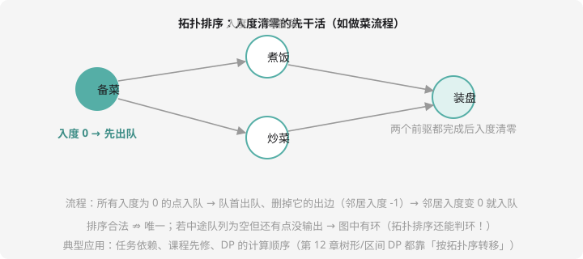

# 拓扑排序

## 一类新问题：顺序的裁判

任务 A 依赖 B（必须先做 B）。所有任务排一个**合法执行顺序**——这就是**拓扑排序（topological sort）**。做菜的流程图：备菜 → （煮饭、炒菜）→ 装盘：



拓扑排序**只对 DAG（有向无环图）存在**——有环就意味着「A 等 B、B 等 A」死锁，谁也排不进。反过来说：**排不出来 = 有环**，所以它还是判环神器。

## Kahn 算法：入度清零法

**入度** = 指向某点的边数 = 「它依赖的任务数」。直觉：**依赖数为 0 的任务随时可以开工**。流程：

1. 所有入度为 0 的点入队
2. 队首出队，输出它，并**删掉它的所有出边**（每个邻居入度 -1）
3. 邻居入度减到 0 → 入队；重复直到队列空
4. 若输出个数 < n → 有环

这正是第 7 章 BFS 队列的又一应用——**队列不但管「距离层次」（BFS），还管「依赖顺序」（拓扑）**。

```cpp
#include <iostream>
#include <vector>
#include <queue>
using namespace std;

const int N = 100005;
vector<int> adj[N];
int indeg[N];

int main() {
    int n, m;
    cin >> n >> m;
    for (int i = 0; i < m; i++) {
        int u, v;
        cin >> u >> v;             // u → v：v 依赖 u
        adj[u].push_back(v);
        indeg[v]++;
    }

    queue<int> q;
    for (int i = 1; i <= n; i++)
        if (indeg[i] == 0) q.push(i);

    vector<int> order;
    while (!q.empty()) {
        int u = q.front(); q.pop();
        order.push_back(u);
        for (int v : adj[u]) {
            if (--indeg[v] == 0) q.push(v);
        }
    }

    if ((int)order.size() < n) cout << "有环！" << endl;
    else for (int x : order) cout << x << " ";
    return 0;
}
```

复杂度 $O(n + m)$，一遍扫完。

## 拓扑序 + DP：图上 DP 的万能骨架

拓扑排序最大的价值不是输出顺序本身，而是给出**无后效性的计算顺序**：

> **「u 依赖 v」在图上是边 v→u；拓扑序里 v 排在 u 前——沿拓扑序做 DP，转移时用到的状态一定已算好。**

经典套路「在 DAG 上求最长路 / 方案数」：

$$f[v] = \max_{(u \to v)} (f[u] + 1)$$

沿拓扑序逐个转移即可（顺序保证 $f[u]$ 就绪）。

## 例题：杂务

> **题目描述**　John 有 $n$ 件杂务，第 $i$ 件耗时 $t_i$，且可能依赖若干件**编号更小**的杂务（依赖全部完成后才能开始；互不依赖的杂务可以并行）。求完成全部杂务最少需要多久。
>
> **输入格式**　第一行一个整数 $n$；接下来 $n$ 行：第 $i$ 行为 `tᵢ k d₁ d₂ …`（耗时、依赖件数、依赖编号）。
>
> **输出格式**　一个整数。
>
> **数据范围**　$1 \le n \le 10^4$，依赖编号均小于 $i$，耗时 $1 \sim 100$。
>
> **样例输入 / 样例输出**
>
> ```text
> 5
> 1 3 0
> 2 2 1 1
> 3 4 1 1
> 4 2 2 2 3
> 5 1 2 3 4
> ```
>
> ```text
> 10
> ```

**思路分析**　「依赖编号更小」——题目直接保证了**按编号循环就是拓扑序**，连队列都省了。DP 状态：`f[i]` = 杂务 i 的**最早完成时刻** = 自身耗时 + 所有依赖中最晚完成的那个：

$$f[i] = t_i + \max_{d \in dep(i)} f[d]$$

答案取所有 f 的最大值。手推样例：$f[1]=3$，$f[2]=2+3=5$，$f[3]=4+3=7$，$f[4]=2+\max(5,7)=9$，$f[5]=1+\max(7,9)=10$ ✅。**并行**的价值就藏在转移里：杂务 4 的两条依赖链谁慢等谁，只取 max。

**参考代码**

```cpp
#include <iostream>
#include <vector>
using namespace std;

long long f[10005];        // f[i] = 杂务 i 的最早完成时刻
vector<int> dep[10005];    // dep[i] = i 依赖的杂务编号列表

int main() {
    int n;
    cin >> n;
    vector<int> t(n + 1);
    for (int i = 1; i <= n; i++) {
        int k;
        cin >> t[i] >> k;
        dep[i].resize(k);
        for (int j = 0; j < k; j++) cin >> dep[i][j];
    }

    // 依赖编号都小于 i ⇒ 按 1..n 循环天然是拓扑序
    long long ans = 0;
    for (int i = 1; i <= n; i++) {
        long long ready = 0;                      // 依赖中最晚完成的
        for (int d : dep[i]) ready = max(ready, f[d]);
        f[i] = ready + t[i];
        ans = max(ans, f[i]);
    }
    cout << ans << endl;
    return 0;
}
```

### 一般 DAG 怎么办？队列版（Kahn + DP）

如果依赖编号没有规律，就先用拓扑队列求顺序，「边弹出边转移」（**推式**转移：u 完成时去更新它的下游 v）：

```cpp
#include <iostream>
#include <vector>
#include <queue>
using namespace std;

long long f[10005];
int t[10005], indeg[10005];
vector<int> adj[10005];   // 边 u → v：v 依赖 u

int main() {
    int n;
    cin >> n;
    for (int i = 1; i <= n; i++) {
        int k;
        cin >> t[i] >> k;
        while (k--) {
            int d;
            cin >> d;
            adj[d].push_back(i);   // d 完成后才能做 i
            indeg[i]++;
        }
    }
    queue<int> q;
    for (int i = 1; i <= n; i++)
        if (indeg[i] == 0) { f[i] = t[i]; q.push(i); }   // 无依赖：立即可做

    long long ans = 0;
    while (!q.empty()) {
        int u = q.front(); q.pop();
        ans = max(ans, f[u]);
        for (int v : adj[u]) {
            f[v] = max(f[v], f[u] + t[v]);   // u 的完成推迟 v 的开工
            if (--indeg[v] == 0) q.push(v);
        }
    }
    cout << ans << endl;
    return 0;
}
```

两种姿势等价：**「拉」式（算 i 时查所有依赖）配按序循环，「推」式（u 出队时更新下游）配拓扑队列**——都要会读。本题就是洛谷 [P1113 杂务](https://www.luogu.com.cn/problem/P1113)（其样例与本题同类，提交版用队列版可无视「依赖编号更小」的题设，更通用）。

## 拓扑的三个高频用途

| 场景 | 用法 |
| ---- | ---- |
| 任务/课程依赖 | 直接输出拓扑序 |
| 判环 | 排不满 n 个点即有环（死锁检测） |
| **DAG 上 DP 的计算顺序** | 沿拓扑序转移（最长路、方案数、期望……） |

第三个用途最值钱——第 12 章的树上 DP、区间 DP，本质都在「找一个无后效的计算顺序」，和拓扑排序是一脉相承的思想。

## 动手试一试

1. 手排：对图 `1→2, 1→3, 2→4, 3→4` 写出全部拓扑序（恰好 2 种：1 2 3 4 和 1 3 2 4——为什么只有 2 种？1 必须第一，2、3 可换，4 必须最后）
2. 改造例题：输出每件杂务的「最晚开始时间」（提示：答案 − 自身后继链，需要反图再推一遍）
3. 判环练习：读入有向图，用 Kahn 判环输出 yes/no；再了解「DFS 三色标记法」怎么判，对比思路
4. 挑战：P1113 提交；再做「哪些杂务可能是关键路径上的」（f[i] + g[i] = ans 的 i，g 为最晚完成时刻——正反两遍拓扑）

---

**第 11 章毕业！** 图论工具箱已经配齐：存图、遍历、最短路、MST、拓扑。下一章把它们和 DP 炼到一起：[第 12 章 · 动态规划进阶](../adv-dp/index.md)。
