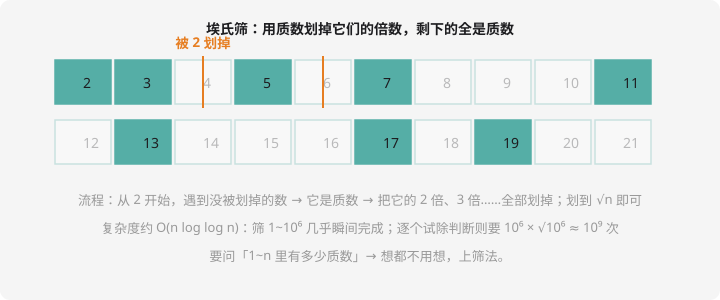

# 质数与公约数

## 质数：数论的原子

**质数（素数）**：大于 1，且只能被 1 和它自己整除。2、3、5、7、11、13……它们是数论的「原子」——**每个大于 1 的整数都能唯一分解成若干质数的乘积**（算术基本定理），例如 $360 = 2^3 \times 3^2 \times 5$。

**合数**：除了 1 和自身还有其他因数。**1 既不是质数也不是合数**（笔试爱考）。

## 质数判断：只试除到 √n

第 4 章写过判断函数，这里升级复盘三个要点：

```cpp
bool isPrime(long long n) {
    if (n < 2) return false;
    for (long long i = 2; i * i <= n; i++) {
        if (n % i == 0) return false;
    }
    return true;
}
```

1. `n < 2` 先排除（0、1 都不是质数）
2. **试除到 $\sqrt{n}$ 即可**：若 $n = p \times q$，两因数必有一个 $\le \sqrt{n}$
3. `i * i <= n` 替代 `i <= sqrt(n)`：不开方、无浮点误差，但注意 `i*i` 要用 `long long` 防溢出

判断**单个**数用它。要问「1~n 里**所有**质数」呢？逐个判断太慢（约 $n\sqrt{n}$），上筛法。

## 埃氏筛：一次筛出所有质数



思想：**质数的倍数一定不是质数**。从 2 开始：遇到没被划掉的数，它就是质数，把它所有的倍数（从平方开始）全划掉。

```cpp
#include <iostream>
using namespace std;

bool comp[1000005];   // comp[i] = true 表示 i 是合数（全局数组自动 false）

int main() {
    int n;
    cin >> n;
    int cnt = 0;
    for (int i = 2; i <= n; i++) {
        if (!comp[i]) {                    // i 没被划掉 → 质数！
            cnt++;
            for (long long j = (long long)i * i; j <= n; j += i)
                comp[j] = true;            // 划掉 i², i²+i, i²+2i, …
        }
    }
    cout << cnt << endl;
    return 0;
}
```

三个细节：

- 从 $i^2$ 开始划：更小的倍数（$2i$、$3i$…）早被更小的质数划过了
- `j += i` 步进，`long long` 防止 `i*i` 溢出
- 复杂度约 $O(n \log \log n)$，筛 $10^6$ 瞬间完成——**「统计质数个数/批量判质」永远用筛法**

这就是洛谷 [P1832 / P3912 质数个数](https://www.luogu.com.cn/problem/P3912) 类题目的标准解。

## 最大公约数：辗转相除法

$\gcd(a, b)$：能同时整除 $a$ 和 $b$ 的最大正整数。第 2 章例题写过模板，这里补上**为什么**：

$$\gcd(a, b) = \gcd(b,\ a \bmod b)$$

证明思路一句话：设 $a = qb + r$，那么 $a$ 和 $b$ 的公因数集合，与 $b$ 和 $r$ 的公因数集合**完全相同**（$r = a - qb$，能整除 $a$、$b$ 的必能整除 $r$，反之亦然）。

```cpp
long long gcd(long long a, long long b) {
    return b == 0 ? a : gcd(b, a % b);
}
```

**最小公倍数**用公式一键搞定：

$$\text{lcm}(a, b) = \frac{a}{\gcd(a,b)} \times b$$

（先除后乘防溢出！）

## 算术基本定理：唯一分解

每个大于 1 的整数都能**唯一**写成质数幂的乘积。用它几个推论立刻得到（笔试常考）：

- **因数个数**：$n = p_1^{e_1} p_2^{e_2} \cdots$，则因数个数 $= (e_1+1)(e_2+1)\cdots$。如 $12 = 2^2 \cdot 3$，因数 $(2+1)(1+1) = 6$ 个：1,2,3,4,6,12
- **判断完全平方数**：分解后所有指数都是偶数
- **$\gcd$ 与 $\text{lcm}$ 的分解视角**：取质因数指数的 min / max

## 例题：最大公约数与最小公倍数

> **题目描述**　读入两个正整数 $a$、$b$，第一行输出 $\gcd(a,b)$，第二行输出 $\text{lcm}(a,b)$。
>
> **输入格式**　一行两个整数。
>
> **输出格式**　两行，最大公约数、最小公倍数。
>
> **数据范围**　$1 \le a, b \le 10^{12}$。
>
> **样例输入 / 样例输出**
>
> ```text
> 12 18
> ```
>
> ```text
> 6
> 36
> ```

**思路分析**　模板题：辗转相除求 gcd，公式求 lcm。**唯一陷阱在 lcm 的写法**：`a * b / gcd` 会在中间溢出（$10^{12} \times 10^{12}$ 远超 long long），必须 `a / gcd * b`。

**参考代码**

```cpp
#include <iostream>
using namespace std;

long long gcd(long long a, long long b) {
    return b == 0 ? a : gcd(b, a % b);
}

int main() {
    long long a, b;
    cin >> a >> b;
    long long g = gcd(a, b);
    cout << g << endl;
    cout << a / g * b << endl;   // 先除后乘，防溢出
    return 0;
}
```

同款题：洛谷 [P5736](https://www.luogu.com.cn/problem/P5736)（质数）、[P1072](https://www.luogu.com.cn/problem/P1072)（NOIP2009 提高 T1，gcd/lcm 综合应用，学完可挑战）。

## 动手试一试

1. 手算：把 2024 分解质因数（答案：$2^3 \times 11 \times 23$）
2. 写程序：1~$n$ 中既是最小公倍数练习——读入 $n$，输出 1~$n$ 中因子最多的数（提示：直接枚举每个数求因数个数，$O(n\sqrt n)$ 在 $n \le 10^4$ 可过）
3. 埃氏筛改写：筛出 1~$n$ 的所有质数并按每行 10 个输出
4. 思考：为什么埃氏筛「从 $i^2$ 开始划」是对的？$i=5$ 时，10、15、20 分别被谁划掉了？

---

下一课：会数数也是算法——[简单计数与排列组合](counting.md)。
