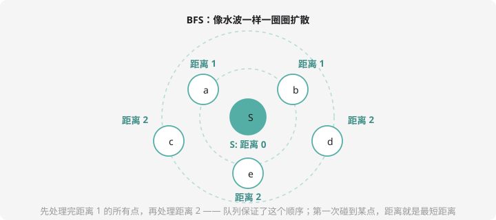

# BFS：层层扩散的水波

## 什么是 BFS？

往池塘里丢一颗石子，水波**一圈一圈**向外扩散——第一圈是紧挨着的点，第二圈再远一步……**BFS（广度优先搜索）**就是这样探索：先看完所有距离 1 的点，再看距离 2 的点，逐层推进。



这个「按距离分层」的顺序，带来 BFS 最重要的性质：

> **第一次到达某个点时，走过的距离一定是最短的。**

因为所有更近的点都已被更早的波及过。所以——**迷宫最短路，BFS 一把梭**。

## 队列：BFS 的发动机

「先处理完距离 1，再处理距离 2」怎么实现？靠第 6 章的**队列**：

1. 起点（距离 0）入队
2. 队首出队，把它的**所有还没访问过的邻居**距离设为「当前 +1」并入队
3. 重复直到队列空

队列先进先出，恰好保证「距离 k 的点全部处理完，距离 k+1 的点才开始」——水波就是这么一圈圈传的。**DFS 用递归（栈），BFS 用队列**，两把武器对应两种秩序。

## 核心模板：迷宫最短路

网格迷宫，`.` 能走 `#` 是墙，求起点到终点最少几步。要点：

- **方向数组** `dx[] dy[]`：上下左右四步用循环统一处理，不用写四遍
- **vis/dist 数组**：既标记「来过」（防止绕圈死循环），又顺手记录最短距离

```cpp
#include <iostream>
using namespace std;

char g[105][105];
int dist[105][105];
int qx[10005], qy[10005];
int dx[4] = {0, 0, 1, -1};    // 右、左、下、上
int dy[4] = {1, -1, 0, 0};

int main() {
    int n, m;
    cin >> n >> m;
    for (int i = 1; i <= n; i++)
        for (int j = 1; j <= m; j++) cin >> g[i][j];

    for (int i = 1; i <= n; i++)
        for (int j = 1; j <= m; j++) dist[i][j] = -1;   // -1 = 没来过

    int head = 1, tail = 0;
    qx[++tail] = 1; qy[tail] = 1;   // 起点入队
    dist[1][1] = 0;                  // 起点距离 0

    while (head <= tail) {
        int x = qx[head], y = qy[head]; head++;   // 队首出队
        for (int d = 0; d < 4; d++) {              // 四个方向逐个试
            int nx = x + dx[d], ny = y + dy[d];
            if (nx < 1 || nx > n || ny < 1 || ny > m) continue;  // 出界
            if (g[nx][ny] == '#') continue;                       // 墙
            if (dist[nx][ny] != -1) continue;                     // 来过
            dist[nx][ny] = dist[x][y] + 1;                        // 距离 +1
            qx[++tail] = nx; qy[tail] = ny;                       // 入队
        }
    }
    cout << dist[n][m] << endl;    // -1 表示到不了
    return 0;
}
```

三个「continue 卫兵」按顺序把三种不合法情况拦在门外：出界 → 墙 → 来过。这套骨架能直接迁移到棋盘、图、状态搜索——**背下来，反复用**。

## 例题：迷宫最短路

> **题目描述**　$N \times M$ 的网格（`.` 可走，`#` 是墙），从左上角 $(1,1)$ 走到右下角 $(N,M)$，每步走上下左右相邻格，求最少步数；到不了输出 `-1`。起点和终点保证可走。
>
> **输入格式**　第一行 $N, M$；接下来 $N$ 行每行一个长度为 $M$ 的字符串。
>
> **输出格式**　一个整数。
>
> **数据范围**　$1 \le N, M \le 100$。
>
> **样例输入 / 样例输出**
>
> ```text
> 3 4
> ....
> .##.
> ....
> ```
>
> ```text
> 5
> ```

**思路分析**　BFS 模板原题。两条路线都是 5 步：上面走 `(1,1)→(1,2)→(1,3)→(1,4)→(2,4)→(3,4)`，下面走 `(1,1)→(2,1)→(3,1)→(3,2)→(3,3)→(3,4)`。BFS 会把所有格子按距离分层，终点第一次被「波及」到时的距离就是 5。

**参考代码**　见上方模板（直接可用）。

同款题：洛谷 [P1443 马的遍历](https://www.luogu.com.cn/problem/P1443)——把「上下左右」换成马的 8 个「日」字跳法，其余一字不改，是检验模板是否真掌握的试金石。

## DFS vs BFS：怎么选？

| | DFS | BFS |
| ---- | ---- | ---- |
| 武器 | 递归（系统栈） | 队列 |
| 顺序 | 一条道到黑，再回头 | 按距离层层推进 |
| 求最短路 | ❌ 不保证 | ✅ 天生保证 |
| 求所有方案 | ✅ 回溯拿手 | 麻烦 |
| 内存 | 深（层数多） | 宽（同层全在队列里） |

口诀：**要「所有方案」用 DFS，要「最短步数」用 BFS**。第 8 章动态规划登场后，「最短路类」问题还会有新解法，但网格最短路 BFS 依然是首选。

## 动手试一试

1. 修改迷宫代码：同时输出最短步数和**一条最短路径**（提示：每个点记录「从哪个格子来的」，从终点沿 prev 往回走）
2. 01 迷宫连通块：图上每个连通的 `.` 区域叫一个连通块，数一数有几个（每个未访问的 `.` 启动一次 BFS）
3. P1443 马的遍历：8 个方向的 `dx dy` 怎么写？拿纸画一画日字跳法的 8 个落点
4. 思考：如果把「每步 1 格」改成「每步可以走 1 格或 2 格」，BFS 还能直接用吗？（提示：步数含义变了，波不再均匀——这就是提高篇「双端队列 BFS / Dijkstra」要解决的问题）

---

下一课：让搜索跑得更快的魔法——[剪枝](prune.md)。
