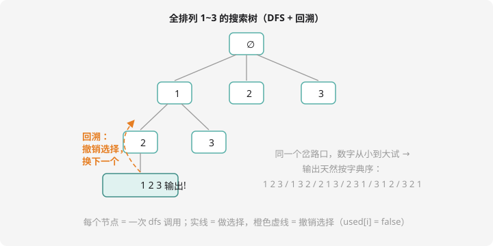

# DFS：一条道走到黑

## 什么是搜索？

很多问题的答案空间巨大，但**规律清晰**：全排列有多少种走法？迷宫怎么走？……**搜索**就是把所有可能性系统地走一遍，边走边检查。

两种走法：

- **DFS（深度优先）**：一条道走到**黑**，撞墙才回头——第 4 章的递归就是它
- **BFS（广度优先）**：像水波一样**层层扩散**——下一课的队列就是它

## DFS 的两个身份

**身份一：递归走到底。** 函数不断调用自己，不断深入，直到出口——这就是 DFS 的骨架。

**身份二：回溯（backtracking）。** 走到头退回来时，要**把刚才的选择撤销**，试下一种可能。「做选择 → 深入 → 撤销选择」三连拍，是 DFS 的灵魂。

## 核心模板：全排列

问题：输出 $1 \sim n$ 的所有排列。思路：**逐个位置填数字**——第 1 个位置从 1 到 n 试，每个位置填完后递归填下一个，填满就输出；返回时撤销刚才的选择，换下一个数试。



```cpp
#include <iostream>
using namespace std;

int n;
int path[10];       // 当前排列：path[1..step] 已填好的部分
bool used[10];      // used[i]：数字 i 是否已被用过

void dfs(int step) {
    if (step > n) {                       // 出口：n 个位置都填满了
        for (int i = 1; i <= n; i++) cout << path[i] << " ";
        cout << endl;
        return;
    }
    for (int i = 1; i <= n; i++) {        // 当前位置从小到大试
        if (!used[i]) {
            path[step] = i;               // ① 做选择
            used[i] = true;
            dfs(step + 1);                // ② 深入下一层
            used[i] = false;              // ③ 撤销选择（回溯！）
        }
    }
}

int main() {
    cin >> n;
    dfs(1);
    return 0;
}
```

对着搜索树读代码：实线是「做选择」，橙色虚线是「撤销选择」回到岔路口。**内层循环从小到大**，所以输出天然按字典序。

三连拍的记忆口诀：**选了要做标记，回来要擦标记**。漏掉第 ③ 步（忘记 `used[i] = false`）是最常见的搜索 bug——结果只输出第一个排列就结束了。

## 例题：全排列问题

> **题目描述**　读入 $n$，按字典序输出 $1 \sim n$ 的所有全排列。
>
> **输入格式**　一个整数 $n$。
>
> **输出格式**　每行一个排列，数字间空格分隔。
>
> **数据范围**　$1 \le n \le 7$。
>
> **样例输入 / 样例输出**
>
> ```text
> 3
> ```
>
> ```text
> 1 2 3
> 1 3 2
> 2 1 3
> 2 3 1
> 3 1 2
> 3 2 1
> ```

**思路分析**　就是上面的模板原题。$n=7$ 时共 $7! = 5040$ 个排列，瞬间出完。注意 $n=8$ 就要 40320 个、$n=10$ 是 362 万个——排列数是**阶乘级**增长的，搜索题的数据范围往往就是防超时设计的。

**参考代码**　见上方模板（一字不改即可 AC）。同款题：洛谷 [P1706 全排列问题](https://www.luogu.com.cn/problem/P1706)（它的输出格式要求每个数字占 5 个字符宽度，提交前读清题面——顺便复习「格式错不得分」）。

## 组合：和排列只差一行

从 $n$ 个数里选 $k$ 个（不计顺序）。和全排列的区别：**只往前选，不回头**——当前位置只能选比上一个大的数，天然不重复：

```cpp
void dfs(int step, int start) {          // 还要选 step 个，从 start 号开始试
    if (step == 0) {                     // 选够了
        // 输出 path[1..k]
        return;
    }
    for (int i = start; i <= n; i++) {
        path[k - step + 1] = i;
        dfs(step - 1, i + 1);            // 下一个只能从 i+1 开始
    }
}
```

`start` 参数替代了 `used[]` 数组——「单调往前走」本身就是去重。洛谷 [P1157 组合的输出](https://www.luogu.com.cn/problem/P1157) 是同款题。

## 动手试一试

1. 手画 $n=3$ 全排列的完整搜索树（6 个叶子都要画出来），标出回溯边
2. 修改全排列代码：故意删掉 `used[i] = false;` 看输出变成什么，体会「擦标记」的作用
3. 输出 $1 \sim n$ 的所有「指数型子集」：每个数有「选 / 不选」两种可能（提示：dfs 里分两个岔：选 step 或不选）
4. 挑战：$n$ 皇后问题——在 $n \times n$ 棋盘放 $n$ 个皇后使任意两个不同行不同列不同对角线，输出方案数（洛谷 P1219，经典 DFS + 标记数组练习）

---

下一课：换一把武器——[BFS：层层扩散的水波](bfs.md)。
