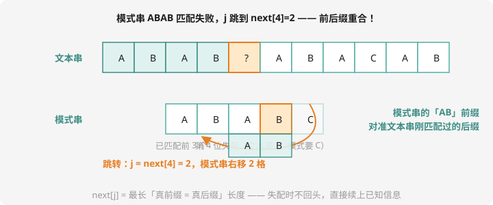

# KMP 算法

## 问题：在长文本里找模式串

文本串 $T$（长 $n$）、模式串 $P$（长 $m$），问 $P$ 在 $T$ 中出现的位置/次数。暴力做法：每个起点逐位比对——$O(nm)$，$n = m = 10^6$ 时 $10^{12}$ 必挂。

暴力的浪费在哪？**每次失配都把文本指针往回退**。可失配时，前面已经匹配过的部分藏着大量「已知信息」——KMP（Knuth-Morris-Pratt）的全部智慧就是**榨干这些信息，文本指针永不回头**。

## next 数组：模式串的自我认知

**定义**：`next[j]` = P 的前 j 个字符中，**最长的「真前缀 = 真后缀」**的长度（「真」= 不能是整个串）。

以 $P = $ `ABABC` 为例手推：

| j | 前 j 个字符 | 最长相等真前后缀 | next[j] |
| :-: | :-: | :-: | :-: |
| 1 | `A` | 无 | 0 |
| 2 | `AB` | 无 | 0 |
| 3 | `ABA` | `A` | 1 |
| 4 | `ABAB` | `AB` | 2 |
| 5 | `ABABC` | 无 | 0 |

它为什么有用？看匹配场景：



文本串已匹配 `ABAB` 后在第 5 位失配。朴素法把文本指针退回去；KMP 发现：**已匹配部分的后缀 `AB` 恰好等于模式串的前缀 `AB`**——把模式串右移 2 格，这两格自动对齐，直接从 `j = next[4] = 2` 继续。文本指针一步没退！

## 求 next：模式串自己匹配自己

求 next 就是「P 与 P 错一位做匹配」，代码短但烧脑，**背模板 + 手推一次**：

```cpp
// next[j]：P[1..j] 的最长相等真前后缀长度（下标从 1 开始）
nxt[1] = 0;
for (int i = 2, j = 0; i <= m; i++) {
    while (j && P[i] != P[j + 1]) j = nxt[j];   // 失配：继续往前跳
    if (P[i] == P[j + 1]) j++;                  // 匹配上：长度 +1
    nxt[i] = j;
}
```

`while` 里的「跳跳跳」就是 next 数组的用法用在自己身上——`P[i] != P[j+1]` 时，j 退到 `nxt[j]`（已匹配部分的前后缀重合处），再试。

## 匹配：文本指针永不回头

```cpp
int cnt = 0;
for (int i = 1, j = 0; i <= n; i++) {
    while (j && T[i] != P[j + 1]) j = nxt[j];   // 失配：j 跳转（i 不动！）
    if (T[i] == P[j + 1]) j++;
    if (j == m) {                                // 完整匹配一次！
        cout << i - m + 1 << endl;               // 起始位置
        cnt++;
        j = nxt[j];                              // 继续找（允许重叠）
    }
}
```

复杂度：i 只增不减走 $n$ 步；j 每次跳转都在变小、每次匹配才 +1——总跳转 ≤ 总增加 = $n$。**均摊 $O(n + m)$**，这就是 KMP。

## 例题：统计出现次数

> **题目描述**　给定文本串 $T$ 和模式串 $P$，求 $P$ 在 $T$ 中出现的次数（允许重叠）。
>
> **输入格式**　两行，各一个字符串（仅大写字母）。
>
> **输出格式**　一个整数。
>
> **数据范围**　$1 \le |P| \le |T| \le 10^6$。
>
> **样例输入 / 样例输出**
>
> ```text
> ABABCABABA
> ABA
> ```
>
> ```text
> 3
> ```

**思路分析**　手数验证：文本 `ABABCABABA`（下标 1~10），模式 `ABA` 出现在起点 **1**（`ABA`BC…）、起点 **6**（…`ABA`BA）、起点 **8**（…`AB`**ABA**）——共 3 次。注意起点 6 和 8 共享位置 8，「允许重叠」正是 `j = nxt[j]` 那一行的意义（若要求不重叠，改为 `j = 0`）。

**参考代码**　把上面「求 next」+「匹配」两段拼进 main 即可（数组开 $2 \times 10^6$）。同款题：洛谷 [P3375 【模板】KMP](https://www.luogu.com.cn/problem/P3375)（它还要求输出 next 数组本身）。

## 记忆口诀

- **next[j] 的含义**：「前 j 个字符」的头尾相似度
- **失配跳转**：`while (j && 不匹配) j = nxt[j];`——跳到「已经重合的部分」继续
- **匹配成功**：`j == m` 时收结果，然后 `j = nxt[j]` 允许重叠继续找
- 复杂度为什么线性：**i 不回头、j 有退有进且净增 ≤ n**

## 动手试一试

1. 手推 `AACAA` 的 next 数组（答案：0 1 0 0 1——第 5 位为什么是 1？`AA` 的后缀 `A` = 前缀 `A`）
2. 手模样例：写出每次失配时 j 从多少跳到多少
3. 把「允许重叠」改成「不重叠」重算样例（答案变 2）
4. 挑战：求最短循环节——若 $m \% (m - nxt[m]) == 0$，则循环节长度为 $m - nxt[m]$（洛谷 P4391 无线传输），想想为什么成立

---

下一课：字符串的另一种指纹——[字符串哈希](string-hash.md)。
