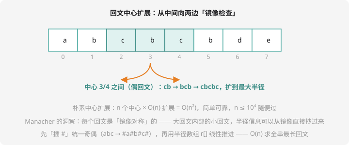

# 回文专题

## 回文：正读反读都一样

`level`、`abba`、上海自来水来自海上——**回文串**是字符串里的美学存在。第 3 章我们用「首尾双指针」判断整个串是不是回文；本章解决进阶版：**找最长回文子串**。

## 方法一：中心扩展（简单可靠）

回文必有一个**中心**（奇回文是一个字符，偶回文是两个字符中间）。枚举每个中心，向两边扩展到镜像失配为止：

```cpp
// 以 l 为左起点的扩展：返回从中心能扩出的最大回文长度
int expand(const string& s, int l, int r) {
    while (l >= 0 && r < (int)s.size() && s[l] == s[r]) { l--; r++; }
    return r - l - 1;   // 多走一步，减回来
}

int longestPalindrome(string s) {
    int ans = 0;
    for (int c = 0; c < (int)s.size(); c++) {
        ans = max(ans, expand(s, c, c));       // 奇长度中心
        ans = max(ans, expand(s, c, c + 1));   // 偶长度中心
    }
    return ans;
}
```

$n$ 个中心 × 每个扩展 $O(n)$ = **$O(n^2)$**。$n \le 10^4$ 随便过——考场上这是性价比最高的写法。



## 方法二：Manacher——线性时间的黑科技

$O(n^2)$ 撑不住 $n = 10^6$。**Manacher 算法**做到 $O(n)$，核心是两个洞察：

**洞察一：插 `#` 统一奇偶。**奇回文中心是字符、偶回文中心是缝隙，分开处理很啰嗦。在每个字符之间和首尾都插上 `#`：

```text
abba  →  # a # b # b # a #     （所有回文都变成奇长度）
```

**洞察二：镜像抄答案。**设当前已知的「右边界最大」的回文中心为 $C$、右边界为 $R$。处理位置 $i < R$ 时，$i$ 关于 $C$ 的镜像点 $i' = 2C - i$ 的回文半径 $r[i']$ **已经算过了**——由于大回文的对称性，$i$ 的半径至少是 $\min(r[i'], R - i)$，**可以直接从这一半开始扩展**（甚至一步到位）。每个位置最多把 $R$ 推进一格，总复杂度 $O(n)$。

```cpp
// 返回最长回文子串长度（manacher 模板，建议整体背下）
int manacher(string s) {
    string t = "^";
    for (char c : s) { t += '#'; t += c; }
    t += "#$";                       // 哨兵防越界
    int n = t.size();
    vector<int> p(n);                // p[i]：i 中心的回文半径
    int C = 0, R = 0;
    for (int i = 1; i < n - 1; i++) {
        int mirror = 2 * C - i;
        if (i < R) p[i] = min(R - i, p[mirror]);   // 镜像抄答案
        while (t[i + p[i]] == t[i - p[i]]) p[i]++;  // 只需扩展剩余部分
        if (i + p[i] > R) { C = i; R = i + p[i]; }  // 更新右边界冠军
    }
    int ans = 0;
    for (int i = 1; i < n - 1; i++) ans = max(ans, p[i]);
    return ans;                      // 插#后半径恰等于原串回文长度
}
```

**不必现场手推全文**，考场上默写模板即可；但要能说清三件事：插 `#` 是为统一奇偶、`min(R-i, p[mirror])` 是镜像抄答案、`C/R` 是右边界冠军。

## 例题：最长回文子串

> **题目描述**　给定字符串 $s$，求最长回文子串的长度。
>
> **输入格式**　一行一个字符串（仅小写字母）。
>
> **输出格式**　一个整数。
>
> **数据范围**　$1 \le |s| \le 10^6$。
>
> **样例输入 / 样例输出**
>
> ```text
> cabbad
> ```
>
> ```text
> 4
> ```

**思路分析**　手验：`c a b b a d` 中 `abba`（中心在 bb 缝隙，扩展到两侧 aa）长 4，没有更长的回文。$n = 10^6$ 下 $O(n^2)$ 必挂，**上 Manacher 模板**。

**参考代码**　即上方 `manacher` 函数 + main 读入输出。同款题：洛谷 [P3805 【模板】Manacher](https://www.luogu.com.cn/problem/P3805)。

## 回文的工具箱总览

| 需求 | 工具 | 复杂度 |
| ---- | ---- | ---- |
| 判断整个串是否回文 | 首尾双指针（第 3 章） | $O(n)$ |
| 最长回文子串（n 小） | 中心扩展 | $O(n^2)$ |
| 最长回文子串（n 大） | Manacher | $O(n)$ |
| 判断任意子串是否回文 | 正反两套哈希 | 预处理 $O(n)$、单次 $O(1)$ |

最后一个是字符串哈希课练习 2 的答案——**哈希+中心扩展还能做「回文拆分计数」**：以每个中心扩展时顺手统计，洛谷搜「回文拆分」「切回文」即有同类题。

## 动手试一试

1. 手推 `abcba` 的中心扩展：奇中心 5 个、偶中心 4 个，各扩到多长？
2. 把 `abbacddc` 插 `#` 写成 Manacher 的处理串，找出最长回文的中心位置
3. Manacher 里为什么有哨兵 `^` 和 `$`？（提示：让 while 的第一个比较必然失配，省掉越界判断）
4. 挑战：把字符串切成若干段，每段都是回文，最少切几刀？（DP + 回文判定，洛谷 P1260? 搜「回文拆分」——状态 `f[i]` = 前 i 个的最少段数，转移枚举 j 且 `j+1..i` 是回文，回文判定用哈希 O(1)）

---

**第 13 章毕业！** KMP、哈希、回文三件套到手。下一章：[第 14 章 · 搜索与优化进阶](../adv-search/index.md)。
