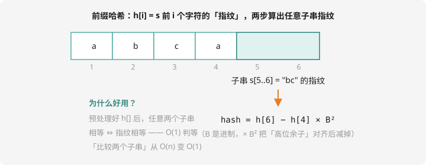

# 字符串哈希

## 思想：给每个字符串发一张「指纹」

把字符串看成一个 $B$ 进制大数，对大质数 $M$ 取模，得到一个整数——这就是**哈希值（指纹）**：

$$hash(s) = \left(\sum_{i=1}^{L} s_i \times B^{L-i}\right) \bmod M$$

约定俗成取 $B = 131$（或 13331）、$M = 2^{64}$（用 `unsigned long long` 自然溢出，连取模都省了）。指纹相同 ⇒ **极大概率**是同一个串。

## 前缀哈希：任意子串的指纹两步算出



预处理 `h[i]` = 前 i 个字符的哈希值，递推一行：

```cpp
h[i] = h[i-1] * B + s[i];
```

任意子串 `s[l..r]` 的指纹：

```cpp
unsigned long long getHash(int l, int r) {
    return h[r] - h[l-1] * pw[r - l + 1];   // pw[k] = B 的 k 次幂（预处理）
}
```

直觉：`h[r]` 是「前缀大数」，减掉「前 l-1 位 × B^(长度)」的错位贡献，剩下正好是中段。**之后任意两个子串的相等判断都是 $O(1)$ 的整数比较**——从 $O(n)$ 砍到 $O(1)$，一大类题直接降维。

## 双哈希：防「指纹撞车」

不同串指纹相同叫**冲突**，概率低但存在，且可被出题人故意构造（**卡单哈希**是出题人 Known 技巧）。对策：用两组 $(B, M)$ 算**两个指纹**，两者都相等才认为相等——冲突概率约 $1/M^2$，实际可视为零：

```cpp
unsigned long long h1[1000006], h2[1000006];
// 两组独立递推：B=131 和 B=137
// 判等：getHash1(l1,r1) == getHash1(l2,r2) && getHash2(...) == getHash2(...)
```

## 例题：不同的子串个数

> **题目描述**　给定字符串 $s$（长度 $n$），求它有多少个**互不相同**的子串（空串不算）。
>
> **输入格式**　一行一个字符串（仅小写字母）。
>
> **输出格式**　一个整数。
>
> **数据范围**　$1 \le n \le 1500$。
>
> **样例输入 / 样例输出**
>
> ```text
> abab
> ```
>
> ```text
> 7
> ```

**思路分析**　$10$ 个子串（$4+3+2+1$）里 `a`、`b`、`ab` 各重复一次 → 7 种不同。暴力枚举所有 $O(n^2)$ 个子串逐个比字符会 $O(n^3)$ 超时；**把每个子串的指纹塞进 `unordered_set`**，指纹 $O(1)$ 入集合，最后数集合大小。$n = 1500$ 时约 112 万个子串，轻松通过。

**参考代码**

```cpp
#include <iostream>
#include <string>
#include <unordered_set>
using namespace std;

int main() {
    string s;
    cin >> s;
    int n = s.size();

    unsigned long long pw[1505], h[1505];
    pw[0] = 1;
    for (int i = 1; i <= n; i++) pw[i] = pw[i-1] * 131;
    for (int i = 1; i <= n; i++) h[i] = h[i-1] * 131 + s[i-1];

    unordered_set<unsigned long long> all;
    for (int l = 1; l <= n; l++)
        for (int r = l; r <= n; r++)
            all.insert(h[r] - h[l-1] * pw[r - l + 1]);

    cout << all.size() << endl;
    return 0;
}
```

（严谨版可在 `set` 里存 `pair` 双哈希；n 更大时要用后缀数组/后缀自动机 $O(n \log n)$，那属于 NOI 级知识了。）同款练习：洛谷搜「不同的子串个数」，弱化版用哈希即可通过。

## 哈希 vs KMP：什么时候用谁？

| 需求 | 首选 |
| ---- | ---- |
| 模式串在文本中的位置/次数 | KMP（严格线性、无冲突） |
| **任意子串 O(1) 判等** | 哈希（KMP 做不到！） |
| 判断子串是否回文 | 正反两套哈希，`hash(l,r) == revHash(l,r)` |
| 多串去重、找公共子串 | 哈希 + set |

**哈希是「以极小概率换巨大灵活」的工具**：写了就双哈希、防卡测；要求绝对正确（如判定题）优先 KMP。

## 动手试一试

1. 手算：串 `ab` 用 B=131 的哈希值（$1 \times 131 + 2$，a=1、b=2 的编码下）
2. 用正反哈希判回文：预处理 `h` 和倒串的 `rh`，写出 `isPal(l, r)` 的判断式（`h[l..r] == rh[n+1-r..n+1-l]`）
3. 例题改成「不同的**回文**子串个数」：$O(n^2)$ 枚举 + 哈希判回文 + set 去重，代码改三处
4. 挑战：找两个串的最长公共子串——二分长度 len，用哈希 + set 判断「是否存在长 len 的公共子串」，$O(n \log n)$

---

下一课：字符串的另一场重头戏——[回文专题](palindrome.md)。
